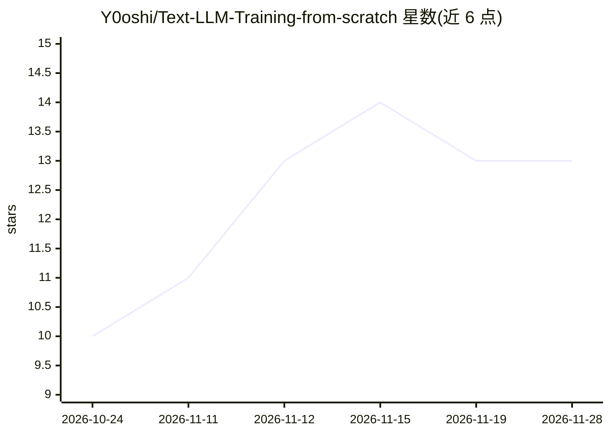

# Y0oshi/Text-LLM-Training-from-scratch

⭐ 13 · Python · MIT · 推送 2026-07-14 · [GitHub](https://github.com/Y0oshi/Text-LLM-Training-from-scratch) · 个人维护

**从零实现 LLM 训练全流程的 PyTorch 教学项目**

用 PyTorch 张量与 autograd 原语直接实现语言模型训练管线，覆盖字节级 BPE 分词器训练、decoder-only Transformer 预训练、SFT（prompt masking）、奖励模型、DPO 与 GRPO/RLVR 对齐，以及 KV cache 生成、HTTP 服务与困惑度/准确率评测。不依赖 transformers/trl/peft 等高层框架，各阶段代码独立成篇便于阅读，附交互式菜单与 llm 命令行两种接口，并给出 17.3M 参数模型在 TinyStories 上的复现示例。面向想逐段理解训练机制的学习者与开发者。

## 筛选速览

| 维度 | 判定 | 备注 |
|---|---|---|
| AI 角色 | `ai-native` | 本体是模型或模型工具 |
| 许可风险 | `permissive` | MIT |
| 部署形态 | `library` | 以包/库形式分发 |
| 模型依赖 | — | README 未给出锁定关系 |
| 硬件要求 | `cpu-ok` | |
| 安装摩擦 | `medium` | 含编译或系统依赖之一 |
| 成熟度 | — | 结构信号不足 |

## 能力要点

- 覆盖 tokenizer→预训练→SFT→DPO/GRPO 全流程，仅用 PyTorch 原语实现
- RoPE/RMSNorm/SwiGLU/GQA/KV cache 等现代组件与参考实现并列并有数值一致性测试
- 同一代码在 CPU、Apple Silicon (MPS)、CUDA 上无需修改运行
- 内置交互式菜单与 llm 命令行，菜单仅构建并回显命令

## 适用场景

- 逐阶段阅读源码理解 LLM 训练与对齐算法的实现细节
- 在笔记本 CPU 或 Apple Silicon 上跑通小型模型的完整训练循环
- 用 TinyStories 等小语料复现 17M 参数模型的预训练与生成
- 自选可验证奖励函数做 GRPO 实验

## 场景标签

`教程课程` `模型训练` `微调` `强化学习` · 领域:学习与行业

## 证据(README 行号)

> L5: A from-scratch implementation of the language-model training pipeline in PyTorch, covering
> L9: `trl`, or `peft`, and each stage is organized to be read and understood on its own.
> L89: The included `configs/tinystories-15m.json` defines a 17.3M-parameter model. Trained on the

## 星数曲线

2026-10-24 10 → 2026-11-28 13（+3）

---
*卡片 v1 · prompt 1.4 · 生成 2026-11-18 · 置信度 high · 依据 README sha `f7e0f72c2a73` · [字段定义](../../DATASET.md)*
