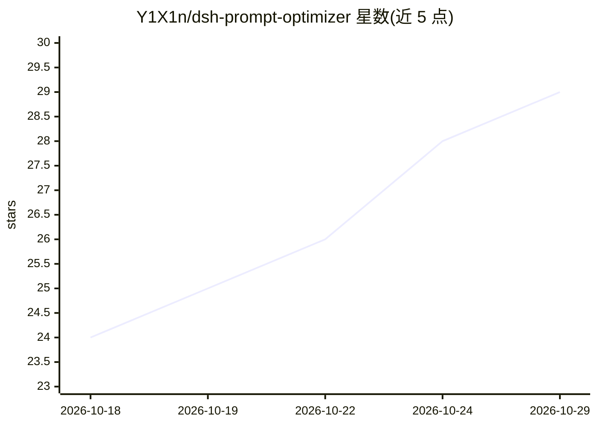

# Y1X1n/dsh-prompt-optimizer

⭐ 29 · TypeScript · MIT · 推送 2026-10-26 · [GitHub](https://github.com/Y1X1n/dsh-prompt-optimizer) · 个人维护 · 中文 README

**DeepSeek Harness 插件：发送栏一键优化提示词草稿并流式上屏**

面向 DeepSeek Harness（dsh）用户的提示词优化插件：在会话输入框旁注入「优化」按钮，调用当前会话的模型路由（可固定或回退）对草稿做五维诊断分析与改写，结果经 SSE 流式逐段显示在结果面板，支持替换（可撤回）/复制/重新优化。提供无上下文模板策略与有上下文意图提炼双策略，带轻量记忆链、斜杠命令保护与超时看门狗。安装依赖 dsh CLI，覆盖 dsh 0.1.0-rc.7 至 0.2.1 版本线，Web 与官方桌面端（Electron）均提供安装路径。

## 筛选速览

| 维度 | 判定 | 备注 |
|---|---|---|
| AI 角色 | `ai-ecosystem` | LLM/agent 周边工具 |
| 许可风险 | `permissive` | MIT |
| 部署形态 | `library` | 以包/库形式分发 |
| 模型依赖 | locked-api |  |
| 硬件要求 | — | 无带数字的原话,不猜 |
| 安装摩擦 | `low` | 无编译、无系统依赖或容器化 |
| 成熟度 | — | 结构信号不足 |

## 能力要点

- 五维诊断（目标清晰度/上下文/约束/结构/输出规格）+ 优化稿 SSE 流式上屏
- 模型路由默认实时跟随当前会话，支持固定模型与失败自动回退
- 双策略：无上下文结构模板改写 / 有上下文意图提炼润色，含轻量记忆链
- 结果面板支持替换（可撤回）/复制/重新优化，按会话隔离

## 适用场景

- 在 DeepSeek Harness 里把粗糙的提示词草稿改写成结构化提示词
- 在 agentic 会话中基于近期对话意图润色现有提示词
- 会话输入时点优化并直接替换输入框内容

## 场景标签

`提示工程` · 领域:Agent 开发

## 证据(README 行号)

> L12: DeepSeek Harness 插件:在会话输入框(发送栏)旁提供一个「优化」按钮(✨ 图标),一键分析并优化当前输入的提示词草稿,**结果经 SSE 流式逐段上屏**。优化调用默认复用当前会话的模型路由(每次点击实时读取,会话
> L14: - **Host 半侧**:注册 `POST /dsh-prompt-optimizer/optimize`(SSE 流式)与 `POST /dsh-prompt-optimizer/test-model`(连通性探活)两条路由,

## 星数曲线

2026-10-18 24 → 2026-10-29 29（+5）

---
*卡片 v1 · prompt 1.4 · 生成 2026-10-26 · 置信度 high · 依据 README sha `e2e05e25ebf0` · [字段定义](../../DATASET.md)*
