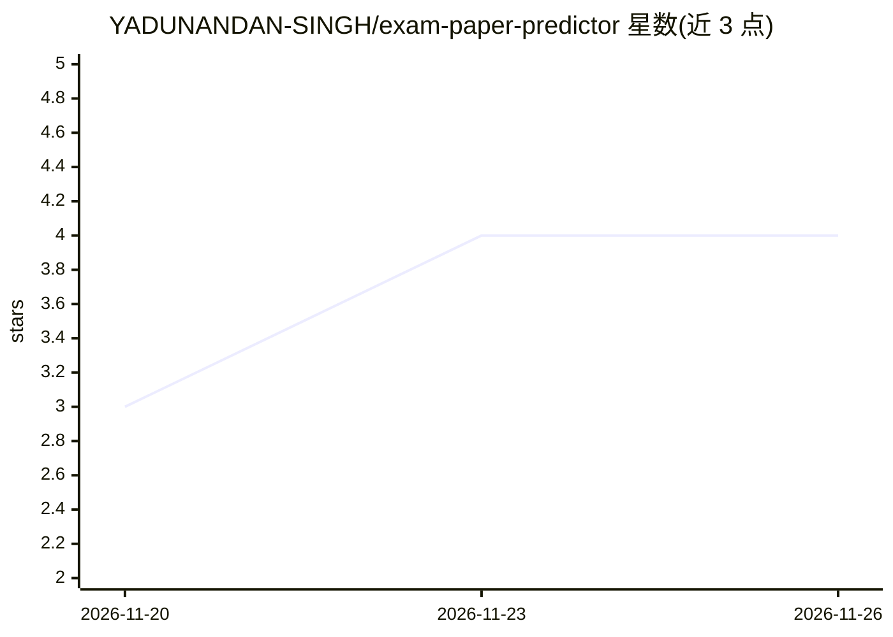

# YADUNANDAN-SINGH/exam-paper-predictor

⭐ 4 · MIT · 推送 2026-11-24 · [GitHub](https://github.com/YADUNANDAN-SINGH/exam-paper-predictor) · 个人维护

**帮考生从历年真题预测下次试卷并生成模拟卷与复习清单**

以 Claude skill 形式分发的考试预测工具：收集 5–20 年真题，用代码计算题型权重与出卷模式，先在不读答案的前提下对近年真题做盲预测回测并打分，再生成模拟卷 PDF、答案解析与必学主题清单。支持学校董事会考试、大学期末考、入学考试等多种形式与任意语言，通过上传 ZIP（Claude 网页/桌面）或 git clone 到 Claude Code 安装，需 Pro 及以上计划或免费版粘贴 SKILL.md。

## 筛选速览

| 维度 | 判定 | 备注 |
|---|---|---|
| AI 角色 | `ai-native` | 本体是模型或模型工具 |
| 许可风险 | `permissive` | MIT |
| 部署形态 | `desktop` | 安装包/桌面程序 |
| 模型依赖 | locked-api |  |
| 硬件要求 | — | 无带数字的原话,不猜 |
| 安装摩擦 | `low` | 无编译、无系统依赖或容器化 |
| 成熟度 | — | 结构信号不足 |

## 能力要点

- 对历年真题做盲预测回测并报告 blind/refined 双分数
- 生成模拟卷、答案解析与必学主题三类专业 PDF
- 支持任意语言与多种考试格式（MCQ、论文、口试等）
- 预测冻结用 SHA-256 哈希固定，匹配由独立子代理与代码完成

## 适用场景

- 备考 CBSE/JEE/NEET 等考试，按题型权重排定复习优先级
- 大学教授自命题期末考前用旧卷生成模拟卷与解析
- 检验预测方法：对已考科目回测打分后再信任清单

## 场景标签

`科研工具` `AI 写作` · 领域:内容生成

## 证据(README 行号)

> L3: A Claude skill that predicts your next exam paper from real past papers (PYQs, past papers, old exams), and **tests 
> L16: 4. **Predict your upcoming paper** and build your PDFs:

## 星数曲线

2026-11-20 3 → 2026-11-26 4（+1）

---
*卡片 v1 · prompt 1.4 · 生成 2026-11-22 · 置信度 high · 依据 README sha `c02f7ce49ad1` · [字段定义](../../DATASET.md)*
