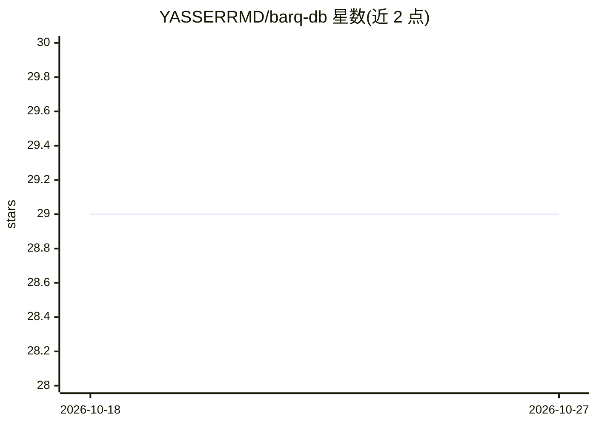

# YASSERRMD/barq-db

⭐ 29 · Rust · MIT · 推送 2026-07-24 · [GitHub](https://github.com/YASSERRMD/barq-db) · 个人维护

**Rust 编写的面向 AI 应用的检索数据系统：向量+BM25 混合搜索**

以 Rust 实现的检索型数据系统，面向 RAG、语义搜索与推荐等 AI 工作负载。提供稠密向量检索（HNSW/IVF/SIMD）、BM25 文本检索与 RRF 融合的混合检索，异步队列化写入带背压处理，采用 Growing→Sealed→Compacted 段生命周期与 mmap 磁盘存储控制内存。API 以 gRPC 为主、REST 兼容，提供 Python/TypeScript/Go/Rust SDK；多副本写路径经 Raft 仲裁提交，但持久化日志与真实节点间传输尚在规划。可用 Docker 或 cargo 从源码运行。README 自述需在真实大规模/分布式场景继续验证。

## 筛选速览

| 维度 | 判定 | 备注 |
|---|---|---|
| AI 角色 | `ai-ecosystem` | LLM/agent 周边工具 |
| 许可风险 | `permissive` | MIT |
| 部署形态 | `self-host` | docker 或自建部署 |
| 模型依赖 | — | README 未给出锁定关系 |
| 硬件要求 | — | 无带数字的原话,不猜 |
| 安装摩擦 | `low` | 无编译、无系统依赖或容器化 |
| 成熟度 | `idea` | |

## 能力要点

- 向量+BM25 混合检索，RRF 确定性融合
- mmap 磁盘存储与可配置内存预算/驱逐
- 队列化异步写入，带显式背压处理
- gRPC 优先 API，Python/TypeScript/Go/Rust 四种 SDK

## 适用场景

- 为 RAG 应用提供向量与关键词混合检索后端
- 需要控制内存占用的大数据集语义搜索
- 持续高写入负载下的检索数据存储

## 场景标签

`向量数据库` · 领域:知识与检索

## 证据(README 行号)

> L22: Barq-DB v2 is a retrieval-focused data system built in Rust for modern AI workloads.
> L33: - RAG systems
> L39: Barq-DB is designed as a retrieval system rather than a standalone vector store.

## 星数曲线

2026-10-18 29 → 2026-10-27 29（+0）

---
*卡片 v1 · prompt 1.4 · 生成 2026-10-26 · 置信度 mid · 依据 README sha `b88bc143ad4a` · [字段定义](../../DATASET.md)*
