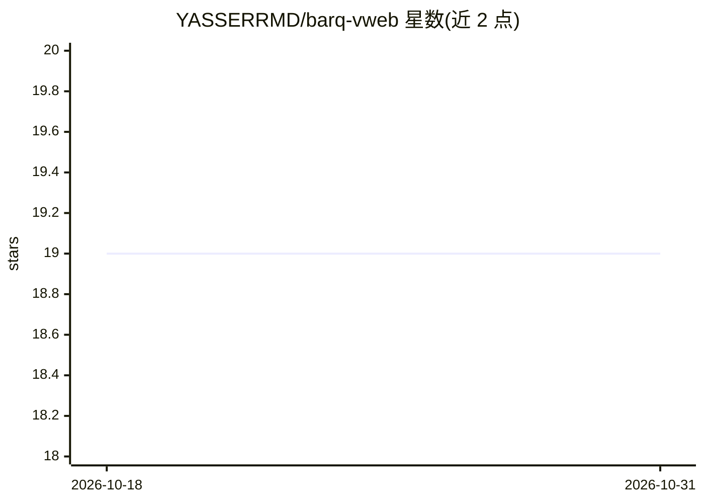

# YASSERRMD/barq-vweb

⭐ 19 · Rust · MIT · 推送 2026-03-13 · [GitHub](https://github.com/YASSERRMD/barq-vweb) · 个人维护

**浏览器端向量数据库：WASM 实现客户端嵌入存储与语义检索**

用 Rust 编写并编译为 WebAssembly 的浏览器原生向量数据库，以 npm 包提供给 Web 应用开发者做客户端嵌入存储与语义搜索。内置 all-MiniLM-L6-v2 嵌入模型（Transformers.js，Web Worker 中运行），提供 HNSW 索引、BM25+向量混合检索（RRF 融合）、SIMD 加速内核与 WebGPU/WebNN 分发、OPFS/IndexedDB 持久化。搜索无服务端依赖；需浏览器支持 WebAssembly 113+/相应特性；也可用 Rust 与 wasm-pack 从源码构建。

## 筛选速览

| 维度 | 判定 | 备注 |
|---|---|---|
| AI 角色 | `ai-ecosystem` | LLM/agent 周边工具 |
| 许可风险 | `permissive` | MIT |
| 部署形态 | `library` | 以包/库形式分发 |
| 模型依赖 | — | README 未给出锁定关系 |
| 硬件要求 | — | 无带数字的原话,不猜 |
| 安装摩擦 | `low` | 无编译、无系统依赖或容器化 |
| 成熟度 | — | 结构信号不足 |

## 能力要点

- Rust 编译为 WebAssembly 的客户端向量数据库，搜索零服务端依赖
- 内置 all-MiniLM-L6-v2 嵌入模型，在 Web Worker 中运行
- HNSW 索引 + BM25/向量混合检索（RRF 融合）
- OPFS/IndexedDB 持久化与 SIMD/WebGPU/WebNN 硬件加速

## 适用场景

- 在前端实现本地语义搜索与 RAG 检索，不依赖服务端
- 为 Web 应用存储与检索文本嵌入向量
- 客户端关键词+语义混合检索场景

## 场景标签

`向量数据库` `语义搜索` · 领域:知识与检索

## 证据(README 行号)

> L9: **barq-vweb** is a high-performance, browser-native vector database designed for modern web applications. It brings 
> L22: - **Self-Contained Embeddings:** Integrated `all-MiniLM-L6-v2` via Transformers.js—runs in a Web Worker to keep you

## 星数曲线

2026-10-18 19 → 2026-10-31 19（+0）

---
*卡片 v1 · prompt 1.4 · 生成 2026-10-28 · 置信度 high · 依据 README sha `678939fe1bed` · [字段定义](../../DATASET.md)*
