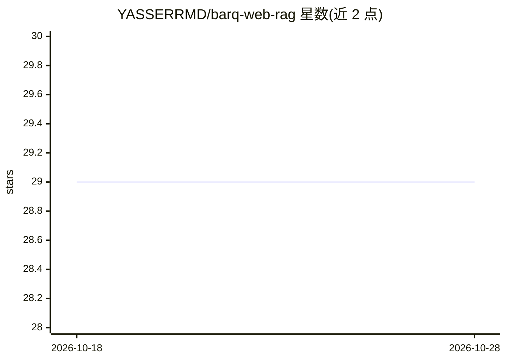

# YASSERRMD/barq-web-rag

⭐ 29 · JavaScript · Apache-2.0 · 推送 2026-03-24 · [GitHub](https://github.com/YASSERRMD/barq-web-rag) · 个人维护

**浏览器内本地 RAG 文档问答应用，数据不出设备**

基于 Rust/WebAssembly 的浏览器原生 RAG 应用：在客户端完成文档摄取（PDF/DOCX/Markdown/TXT 并行处理）、HNSW+BM25 混合检索（RRF 重排）、本地向量存储与持久化，并通过 transformers.js/WebGPU 在浏览器内直接运行 LLM 推理（如 LFM2.5），全程无需外部 API。要求支持 WebGPU 与 WASM 线程的现代浏览器（Chrome/Edge 113+、Safari 17+）。通过 npm 安装依赖并以 npm run dev 启动。

## 筛选速览

| 维度 | 判定 | 备注 |
|---|---|---|
| AI 角色 | `ai-native` | 本体是模型或模型工具 |
| 许可风险 | `permissive` | Apache-2.0 |
| 部署形态 | `library` | 以包/库形式分发 |
| 模型依赖 | — | README 未给出锁定关系 |
| 硬件要求 | — | 无带数字的原话,不猜 |
| 安装摩擦 | `low` | 无编译、无系统依赖或容器化 |
| 成熟度 | — | 结构信号不足 |

## 能力要点

- 浏览器内完成嵌入、向量检索与 LLM 推理，无外部 API 依赖
- HNSW + BM25 混合检索并做 RRF 重排
- 并行摄取 PDF/DOCX/Markdown/TXT 文档
- SIMD 加速的 WASM 计算内核与多 worker 编排

## 适用场景

- 在浏览器里对私有文档做问答而不上传数据
- 离线或无 API key 环境下使用本地 RAG
- 需要端侧向量检索与本地推理的文档问答演示

## 场景标签

`文档问答` `RAG` · 领域:知识与检索

## 证据(README 行号)

> L3: A high-performance, browser-native Retrieval-Augmented Generation (RAG) platform. This application enables local doc
> L12: - **AI Inference**: transformers.js / WebGPU – Running local LLMs (e.g., LFM2.5) directly on the client hardware.

## 星数曲线

2026-10-18 29 → 2026-10-28 29（+0）

---
*卡片 v1 · prompt 1.4 · 生成 2026-10-26 · 置信度 high · 依据 README sha `e127fbecf4c4` · [字段定义](../../DATASET.md)*
