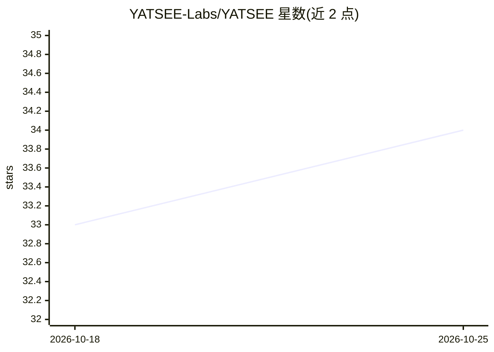

# YATSEE-Labs/YATSEE

⭐ 34 · Python · AGPL-3.0 · 推送 2026-07-27 · [GitHub](https://github.com/YATSEE-Labs/YATSEE) · 组织维护

**本地优先的会议媒体转写与结构化情报流水线**

面向公民、记者、研究者与监督者的 local-first 流水线：从本地媒体出发，依次执行音频规范化、语音转写（faster-whisper）、文本规范化，并生成带时间戳的转写稿、结构化 civic 记录、确定性会议事件与摘要。记录阶段按 chunk 调用 LLM 抽取，事件阶段完全确定性不调用 LLM；产物可审计、可复用，转写与记录 QA 通过 yatsee audit 命令族完成。要求 Python 3.11+、ffmpeg/ffprobe 及配置的本地或托管 LLM 提供方，默认本地路径为 Ollama；源码安装并附 setup 脚本，AGPL v3 许可另提供商业授权。

## 筛选速览

| 维度 | 判定 | 备注 |
|---|---|---|
| AI 角色 | `ai-native` | 本体是模型或模型工具 |
| 许可风险 | `dual` | AGPL-3.0 |
| 部署形态 | `None` |  |
| 模型依赖 | local-ok | 支持本地模型 |
| 硬件要求 | — | 无带数字的原话,不猜 |
| 安装摩擦 | `medium` | 含编译或系统依赖之一 |
| 成熟度 | — | 结构信号不足 |

## 能力要点

- 媒体→规范化音频→转写→记录→事件→摘要的分阶段可审计流水线
- 事件生成完全确定性，不调用 LLM；记录按 hash 缓存复用
- 支持时间戳对齐回源视频与 prompt profile 定制
- 提供 yatsee audit 转写/记录 QA 与显式的 LLM 提供方网络信任边界

## 适用场景

- 把数小时的政府会议录像转成可检索的结构化记录与摘要
- 追溯每条提取记录回到源媒体的时间戳证据
- 对转写稿与记录产物做质检与修复

## 场景标签

`语音识别` · 领域:感知与多模态

## 证据(README 行号)

> L7: YATSEE is a local-first pipeline for turning long-form meeting media into clean, searchable, and auditable intellige
> L26: YATSEE reduces that barrier. It combines local speech recognition, deterministic processing, and constrained langua
> L110: yatsee audio transcribe -e example_county_board --faster

## 星数曲线

2026-10-18 33 → 2026-10-25 34（+1）

---
*卡片 v1 · prompt 1.4 · 生成 2026-10-25 · 置信度 high · 依据 README sha `deda9b2526cb` · [字段定义](../../DATASET.md)*
