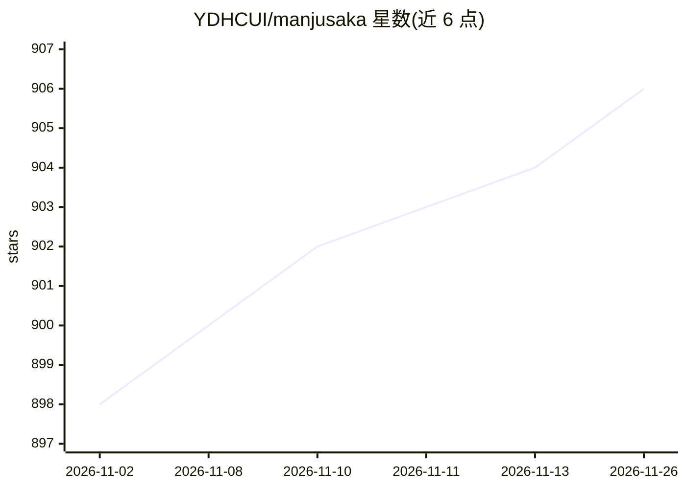

# YDHCUI/manjusaka

⭐ 906 · Rust · 推送 2026-11-23 · [GitHub](https://github.com/YDHCUI/manjusaka) · 个人维护 · 中文 README

**红队/运维人员用的 AI 决策与执行分离的远程主机管理平台**

基于 Rust 的全平台远程管理平台，由管理服务器（NPS）、轻量客户端 NPC1、全功能客户端 NPC2 与 Web 前端组成，覆盖终端、VNC 远程桌面、文件传输、SOCKS5 代理/端口转发、插件执行（BOF/EXE/.NET）等功能。核心机制是 AI 决策与执行分离：AI（基于 adk-rust 框架）只做分析与规划，通过 RPC 调用远端 Agent 上的工具执行，危险操作需弹窗确认；内置 MCP 端点（JSON-RPC + 令牌鉴权）供 Claude/Cursor 等 AI 客户端接入，暴露 15 个 nps_* 工具。README 未提供完整安装/运行说明于可见部分。

## 筛选速览

| 维度 | 判定 | 备注 |
|---|---|---|
| AI 角色 | `ai-enhanced` | 去掉 AI 部分产品仍成立 |
| 许可风险 | `none` | — |
| 部署形态 | `desktop` | 安装包/桌面程序 |
| 模型依赖 | — | README 未给出锁定关系 |
| 硬件要求 | — | 无带数字的原话,不猜 |
| 安装摩擦 | `low` | 无编译、无系统依赖或容器化 |
| 成熟度 | — | 结构信号不足 |

## 能力要点

- AI 决策与执行分离：AI 仅分析规划，执行在远端 Agent 完成，危险操作弹窗确认
- 内置 MCP 端点（POST /mcp，令牌鉴权），Claude/Cursor 可直接接入 15 个 nps_* 工具
- 支持 NPC1（HTTP/S3 信箱回连）、NPC2（TCP/KCP/WS 回连）、SSH 原生连接三种接入方式
- QQ/Telegram 机器人入口，支持 BOF、EXE、.NET 插件生态

## 适用场景

- 通过 Web 控制台统一管理多台远程主机的终端、文件与网络代理
- 在 QQ/聊天界面以对话方式让 AI 规划并分步执行远程操作
- 目标出网受限场景下经 S3 对象存储信箱（OSS/MinIO）中转通信
- 通过 SSH 协议免安装 Agent 直接接管目标终端/SFTP/代理

## 场景标签

`网络安全` · 领域:学习与行业

## 证据(README 行号)

> L21: Manjusaka（牛屎虾）——基于 Rust 的全平台远程管理平台，以 **AI 决策与执行分离**架构为核心：AI 仅负责分析与规划，执行端在远端运行，避免 AI 直接操作本地环境。实现全平台支持、插件生态与趣味交互的完美融合
> L442: AI 助手**不直接执行操作**，而是通过 RPC 调用远端 Agent 上的工具。所有执行在 Agent 端完成，NPS 仅传递指令和结果。
> L249: MCP（Model Context Protocol）服务**内置在 nps 中**（`nps/src/npu/mcp.rs`），无独立组件，

## 星数曲线

2026-11-02 898 → 2026-11-26 906（+8）

---
*卡片 v1 · prompt 1.4 · 生成 2026-11-25 · 置信度 mid · 依据 README sha `2f4a3bd32c28` · [字段定义](../../DATASET.md)*
