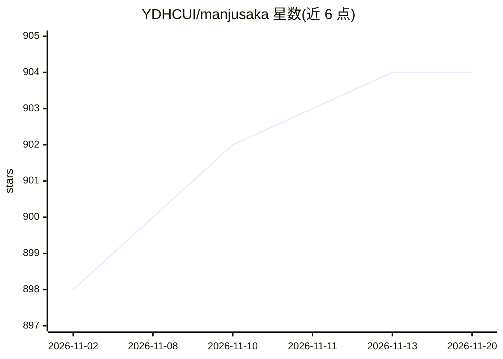

# YDHCUI/manjusaka

⭐ 904 · Rust · 推送 2026-11-06 · [GitHub](https://github.com/YDHCUI/manjusaka) · 个人维护 · 中文 README

**AI 辅助的全平台远程主机管理与渗透工具（C2 框架）**

基于 Rust 的远程管理平台，包含管理服务器 NPS、轻量客户端 NPC1（HTTP/S3 信箱回连）、增强客户端 NPC2（TCP/KCP/WS，支持终端、VNC、SFTP、SOCKS5）与 SSH 原生直连三种接入方式。AI 部分采用决策与执行分离架构：AI 仅分析与规划，通过 RPC 调用远端 Agent 的 21 个 nps_* 工具，危险操作弹窗确认；内置 MCP 端点供 Claude/Cursor 接入，支持 QQ/Telegram 机器人对话操作。数据库 SQLCipher 全库加密。

## 筛选速览

| 维度 | 判定 | 备注 |
|---|---|---|
| AI 角色 | `ai-enhanced` | 去掉 AI 部分产品仍成立 |
| 许可风险 | `none` | — |
| 部署形态 | `desktop` | 安装包/桌面程序 |
| 模型依赖 | — | README 未给出锁定关系 |
| 硬件要求 | — | 无带数字的原话,不猜 |
| 安装摩擦 | `low` | 无编译、无系统依赖或容器化 |
| 成熟度 | — | 结构信号不足 |

## 能力要点

- AI 决策与执行分离：AI 只分析与规划，执行在远端 Agent 完成
- 内置 MCP 端点（14+ 个 nps_* 工具，JSON-RPC + 令牌鉴权），Claude/Cursor 可直接接入
- NPC1 支持 HTTP/S3 对象存储信箱回连，含随机心跳抖动、TCP 隐藏、字符串混淆等反检测特性
- NPC2 支持 VNC 虚拟桌面、终端、SFTP、SOCKS5，可加载 BOF/EXE/.NET 插件

## 适用场景

- 安全测试中统一管理 Windows/Linux/macOS 多平台受控主机
- 通过 AI 聊天或 QQ/Telegram 机器人以自然语言执行渗透操作
- 把 Claude/Cursor 等 MCP 客户端接入作为远程主机操作通道
- 目标出网受限时经 OSS/MinIO S3 信箱间接通信

## 场景标签

`网络安全` · 领域:学习与行业

## 证据(README 行号)

> L21: Manjusaka（牛屎虾）——基于 Rust 的全平台远程管理平台，以 **AI 决策与执行分离**架构为核心：AI 仅负责分析与规划，执行端在远端运行，避免 AI 直接操作本地环境。实现全平台支持、插件生态与趣味交互的完美融合
> L27: - 🔥 **AI决策分离**：AI 只动脑，不动手，再也不怕"龙虾"清空你的本机文件
> L34: - 💬 **AI聊天**：基于 adk-rust 框架，通过聊天的方式进行渗透，危险操作弹窗确认
> L432: ## 🤖 AI 决策与执行分离

## 星数曲线

2026-11-02 898 → 2026-11-20 904（+6）

---
*卡片 v1 · prompt 1.4 · 生成 2026-11-17 · 置信度 mid · 依据 README sha `d95592ecf601` · [字段定义](../../DATASET.md)*
