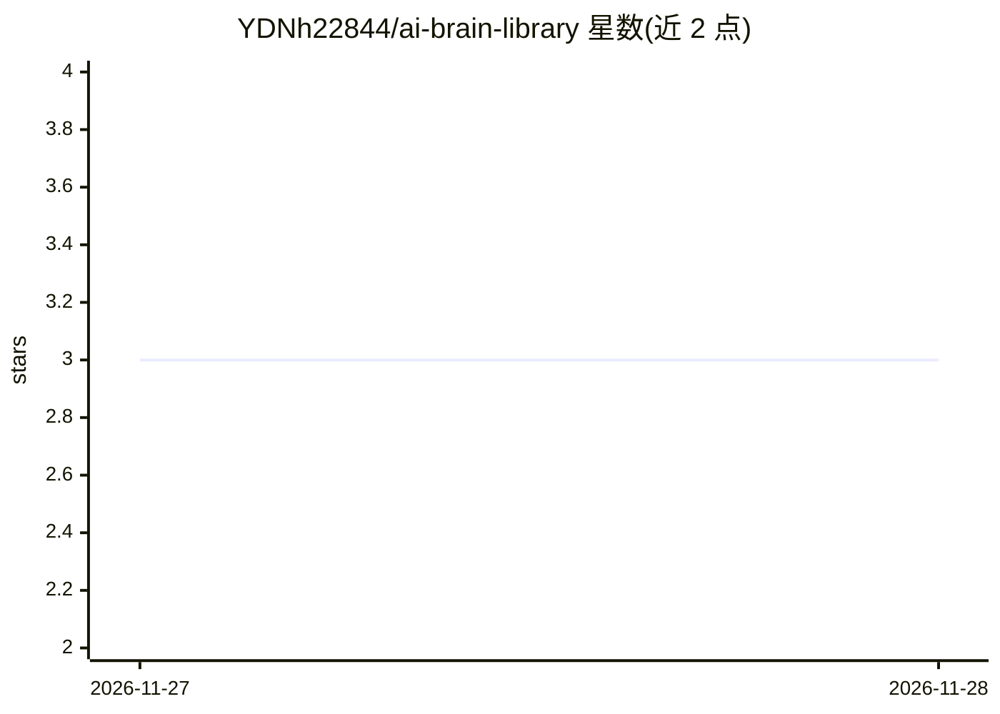

# YDNh22844/ai-brain-library

⭐ 3 · NOASSERTION · 推送 2026-11-25 · [GitHub](https://github.com/YDNh22844/ai-brain-library) · 个人维护 · 中文 README

**给 AI 伴侣/Agent 的一套可核对、可裁剪的记忆结构框架**

一份通用框架文档而非可运行软件：提出五房间记忆结构（书库/目录/管理员/阅读桌/读书笔记）配合世界树证据规则（事实锚/记录/叙事分层、来源与状态标记）与灵枢索引思路，解决长期记忆检索噪声、事实与叙事混杂、记忆跨 AI 迁移等问题。给出最小可用版本（MVL）五步与 L0-L2 落地层级，要求上下文写入只有一个总入口网关。适用于有长期记忆、文件系统、RAG 或工具调用能力的 AI 伴侣/Agent；不保证记忆永不遗忘或检索无损。

## 筛选速览

| 维度 | 判定 | 备注 |
|---|---|---|
| AI 角色 | `ai-knowledge` | 知识聚合/清单类 |
| 许可风险 | `none` | NOASSERTION |
| 部署形态 | `None` |  |
| 模型依赖 | — | README 未给出锁定关系 |
| 硬件要求 | — | 无带数字的原话,不猜 |
| 安装摩擦 | `low` | 无编译、无系统依赖或容器化 |
| 成熟度 | `idea` | |

## 能力要点

- 五房间结构：长期记忆、索引、检索、工作记忆、巩固分层
- 世界树证据规则：每张卡有来源/日期与 active/stale/sealed/quarantined 状态
- MVL 最小版本不需要向量库，可用文件索引维护
- START-HERE.md 作为入口提示词可整份发给其他 AI 使用

## 适用场景

- 给有长期记忆能力的 AI 伴侣搭建可审计的记忆结构
- 解决对话中事实、转述、猜测混杂导致回答失真的问题
- 换用另一个 AI 时迁移整套记忆数据
- 为 Agent 设计上下文写入预算与检索排序策略

## 场景标签

`Agent 记忆` · 领域:Agent 开发

## 证据(README 行号)

> L5: > 版本：v0.1（通用框架稿）
> L7: > 适用：有长期记忆、文件系统、RAG、插件或工具调用的 AI 伴侣 / Agent

## 星数曲线

2026-11-27 3 → 2026-11-28 3（+0）

---
*卡片 v1 · prompt 1.4 · 生成 2026-11-27 · 置信度 high · 依据 README sha `ad62a44f852e` · [字段定义](../../DATASET.md)*
