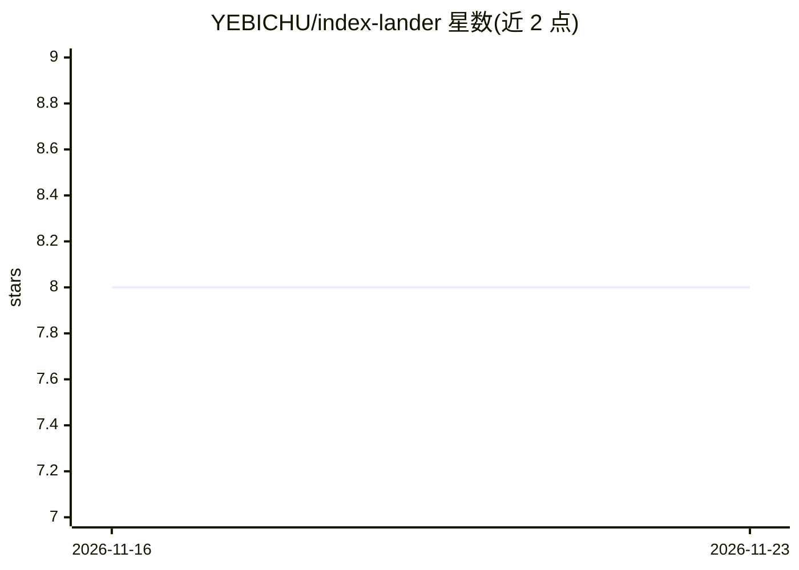

# YEBICHU/index-lander

⭐ 8 · HTML · 推送 2026-10-14 · [GitHub](https://github.com/YEBICHU/index-lander) · [官网](https://index.yebichu.com) · 个人维护

**向投资者发布 BVB 蓝筹算法指数月度配置的静态报告站**

YEBICHU Romania 是一个针对布加勒斯特证券交易所 20 只高流动性蓝筹股的规则型、仅做多股票指数的报告站点（RO/EN 双语静态站）。月度配置由一个小型前馈神经网络生成：模型自 2015 年历史数据每月重校准，输入各股 1/3/6/12 个月收益率、3 个月已实现波动率与 1 个月收益相对排名，共享 encoder 学习表示，decoder 输出和为 100% 的 long-only 权重，单资产上限 30%，并保留现金仓位。提供 Balanced/Dynamic/Concentrated 三种主动风险变体，公开历史曲线、回撤、月度调仓与 methodology；声明内容非投资建议，结果为扣除成本的历史模拟。

## 筛选速览

| 维度 | 判定 | 备注 |
|---|---|---|
| AI 角色 | `ai-native` | 本体是模型或模型工具 |
| 许可风险 | `none` | — |
| 部署形态 | `None` |  |
| 模型依赖 | — | README 未给出锁定关系 |
| 硬件要求 | — | 无带数字的原话,不猜 |
| 安装摩擦 | `low` | 无编译、无系统依赖或容器化 |
| 成熟度 | — | 结构信号不足 |

## 能力要点

- 1,018 参数前馈神经网络，每月基于 2015 年起历史重校准
- 三种风险变体（Balanced/Dynamic/Concentrated），单资产上限与现金仓位机制
- 每月 15 日再平衡、16 日执行，公开调仓与换手数据
- RO/EN 双语静态站点，GitHub Pages 镜像

## 适用场景

- 查看 BVB 蓝筹指数的当月资产配置与历史表现
- 研究神经网络驱动的指数构建方法论
- 跟踪三个风险等级变体的月度再平衡记录

## 场景标签

`金融量化` · 领域:学习与行业

## 证据(README 行号)

> L5: **Abstract (EN).** YEBICHU Romania is a rules-based, long-only equity index over the 20 most liquid blue chips of th
> L51: Sumar: fiecare acțiune intră în model cu randamentul pe 1, 3, 6 și 12 luni, volatilitatea realizată pe 3 luni și ra

## 星数曲线

2026-11-16 8 → 2026-11-23 8（+0）

---
*卡片 v1 · prompt 1.4 · 生成 2026-11-20 · 置信度 mid · 依据 README sha `6420614838bb` · [字段定义](../../DATASET.md)*
