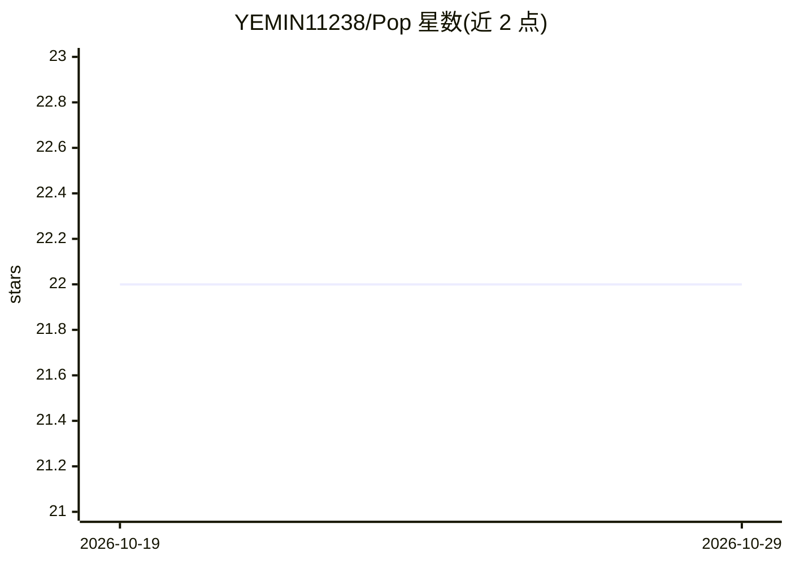

# YEMIN11238/Pop

⭐ 22 · Swift · MIT · 推送 2026-10-17 · [GitHub](https://github.com/YEMIN11238/Pop) · [官网](https://yemin11238.github.io/Pop/) · 个人维护 · 中文 README

**macOS 划词翻译、截图 OCR 与本地词典的菜单栏工具**

面向普通 macOS 用户的取词翻译与文字识别应用：划词翻译（⌥D）、截图/选图 OCR、本地英汉词典（⌥A），分别依托 Apple 系统翻译框架、Apple Vision OCR 与随包提供的 ECDICT 词库，默认无需 API Key。另支持自定义 OpenAI 兼容云 API 及 Ollama/LM Studio 本地模型。提供 DMG/ZIP 安装包（macOS 15+，Apple Silicon/Intel），无需编译；当前发布包未签名未公证，首次打开需系统确认。受 Bob 使用方式启发，为独立实现，不承诺与 Bob 完全相同。

## 筛选速览

| 维度 | 判定 | 备注 |
|---|---|---|
| AI 角色 | `ai-native` | 本体是模型或模型工具 |
| 许可风险 | `permissive` | MIT |
| 部署形态 | `None` |  |
| 模型依赖 | local-ok | 支持本地模型 |
| 硬件要求 | — | 无带数字的原话,不猜 |
| 安装摩擦 | `low` | 无编译、无系统依赖或容器化 |
| 成熟度 | — | 结构信号不足 |

## 能力要点

- 划词翻译、截图/选图 OCR、本地词典三大场景，默认无需 API Key
- 支持 OpenAI 兼容接口及 Ollama/LM Studio 本地模型等可配置服务
- 词典随包离线查询，API Key 存于 macOS 钥匙串
- 提供 PopClip / Raycast / Alfred 集成包与部分 .bobplugin API 兼容

## 适用场景

- 阅读外文资料时划词即时翻译并复制或回填
- 从截图或本地图片提取中英文字并复制
- 离线查询单词和词组的英汉释义

## 场景标签

`OCR` · 领域:感知与多模态

## 证据(README 行号)

> L3: 在不同应用中快速取词、翻译和识别图片文字，支持本地词典及自定义 AI 服务。
> L25: 在 OCR 窗口点击「截图 OCR」，拖动框选包含文字的区域，检查、编辑并复制识别结果。默认使用本机 Apple Vision，无需个人云 API Key；屏幕框选需要录屏权限。也可以从菜单栏选择「选图 OCR…」读取本地图片。
> L53: |**Apple Vision OCR**|默认启用；选图即用，截取屏幕需录屏权限|本机识别，不向云 OCR 服务发送图片|

## 星数曲线

2026-10-19 22 → 2026-10-29 22（+0）

---
*卡片 v1 · prompt 1.4 · 生成 2026-10-27 · 置信度 high · 依据 README sha `194b9d5c0c75` · [字段定义](../../DATASET.md)*
