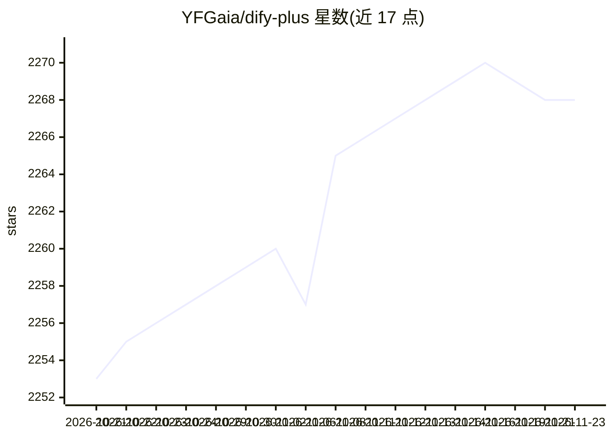

# YFGaia/dify-plus

⭐ 2,268 · Python · NOASSERTION · 推送 2026-11-18 · [GitHub](https://github.com/YFGaia/dify-plus) · 组织维护 · 中文 README

**基于 Dify 的企业 AI 应用平台二次开发版，增加企业身份与额度管理**

在 Dify 原生架构上的社区二次开发项目，保留其应用开发能力（可视化工作流、Agent、知识库 RAG、模型与插件管理、应用发布与服务 API），并移除独立后台，用 Dify 原生前端与权限体系承载系统管理。新增能力包括 Casdoor 单点登录与空间角色映射、钉钉扫码登录、通用 OAuth2 配置、按账号的个人额度与消费归因、应用 API 密钥日/月限额、应用中心分发、代码沙箱授权名单与工作流记录归档。通过 Docker Compose 部署，镜像发布于 GHCR 并需账号登录拉取。

## 筛选速览

| 维度 | 判定 | 备注 |
|---|---|---|
| AI 角色 | `ai-ecosystem` | LLM/agent 周边工具 |
| 许可风险 | `none` | NOASSERTION |
| 部署形态 | `self-host` | docker 或自建部署 |
| 模型依赖 | — | README 未给出锁定关系 |
| 硬件要求 | — | 无带数字的原话,不猜 |
| 安装摩擦 | `low` | 无编译、无系统依赖或容器化 |
| 成熟度 | — | 结构信号不足 |

## 能力要点

- Casdoor SSO 集成与空间角色映射，无需独立部署管理后台
- 按账号的个人额度维护、消费归因与人民币金额显示
- 应用 API 密钥日/月消费限额与调用前校验
- 钉钉扫码登录与通用 OAuth2 集成配置

## 适用场景

- 企业内部统一身份接入并管理 Dify 应用平台的用户额度
- 按日/月限制各应用 API 密钥的消费
- 在空间内集中分发已发布的应用
- 归档工作流运行记录以降低数据库留存压力

## 场景标签

`工作流自动化` `RAG` · 领域:效率与自动化

## 证据(README 行号)

> L3: Dify-Plus 是基于 Dify 的企业 AI 应用平台，提供可视化工作流、Agent、知识库与 RAG、模型与插件管理、应用发布及服务 API，并在同一套 Console 中提供企业身份接入、空间权限、个人额度、API 密钥限
> L5: 本仓库保留 Dify 的应用开发能力，去除了 gin-vue-admin（GVA）独立后台，使用 Dify 原生前端、后端和权限体系承载系统管理，无需另行部署管理后台。

## 星数曲线

2026-10-21 2,253 → 2026-11-23 2,268（+15）

---
*卡片 v1 · prompt 1.4 · 生成 2026-11-23 · 置信度 high · 依据 README sha `930e69138720` · [字段定义](../../DATASET.md)*
