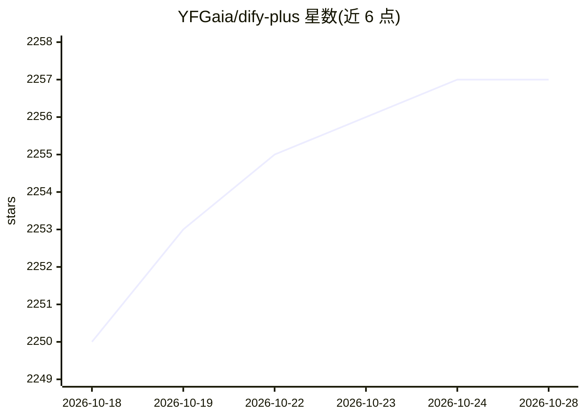

# YFGaia/dify-plus

⭐ 2,258 · Python · NOASSERTION · 推送 2026-10-28 · [GitHub](https://github.com/YFGaia/dify-plus) · 个人维护 · 中文 README

**面向企业的 Dify 增强发行版：SSO、额度与统一管理**

Dify 的社区二次开发版本，保留原生的可视化工作流、Agent、知识库 RAG、模型与插件管理及服务 API 能力，并去掉独立的 GVA 管理后台，用 Dify 原生前后端承载系统管理。新增功能包括：Casdoor SSO 与空间角色映射、钉钉扫码登录、通用 OAuth2 集成、个人额度与消费归因、应用 API 密钥日/月限额、应用中心分发、WebApp 登录控制、代码执行沙箱授权与工作流记录归档。以 Docker Compose 部署，提供多架构容器镜像；Casdoor 目前仅支持 Community 本地模式，商业授权需遵循 Dify 官方条款。给需要企业身份接入与额度管控的自托管团队使用。

## 筛选速览

| 维度 | 判定 | 备注 |
|---|---|---|
| AI 角色 | `ai-ecosystem` | LLM/agent 周边工具 |
| 许可风险 | `none` | NOASSERTION |
| 部署形态 | `self-host` | docker 或自建部署 |
| 模型依赖 | — | README 未给出锁定关系 |
| 硬件要求 | — | 无带数字的原话,不猜 |
| 安装摩擦 | `low` | 无编译、无系统依赖或容器化 |
| 成熟度 | — | 结构信号不足 |

## 能力要点

- Casdoor SSO 与空间角色映射、钉钉扫码登录、通用 OAuth2 集成
- 个人额度与消费归因，应用 API 密钥日/月限额
- 应用中心发布分发与 WebApp 登录控制
- 基于 Dify 原生前后端承载系统管理，无需独立部署管理后台

## 适用场景

- 企业在自托管 Dify 上接入统一身份登录
- 为员工和应用 API 设置额度与消费上限
- 在空间内集中分发和管理工作流应用

## 场景标签

`工作流自动化` `RAG` · 领域:效率与自动化

## 证据(README 行号)

> L3: Dify-Plus 是基于 Dify 的企业 AI 应用平台，提供可视化工作流、Agent、知识库与 RAG、模型与插件管理、应用发布及服务 API，并在同一套 Console 中提供企业身份接入、空间权限、个人额度、API 密钥限
> L101: |可视化工作流与 Chatflow|编排模型、工具、条件、代码、检索及多步骤处理|

## 星数曲线

2026-10-18 2,250 → 2026-10-28 2,257（+7）

---
*卡片 v1 · prompt 1.4 · 生成 2026-10-21 · 置信度 high · 依据 README sha `df90c528fb58` · [字段定义](../../DATASET.md)*
