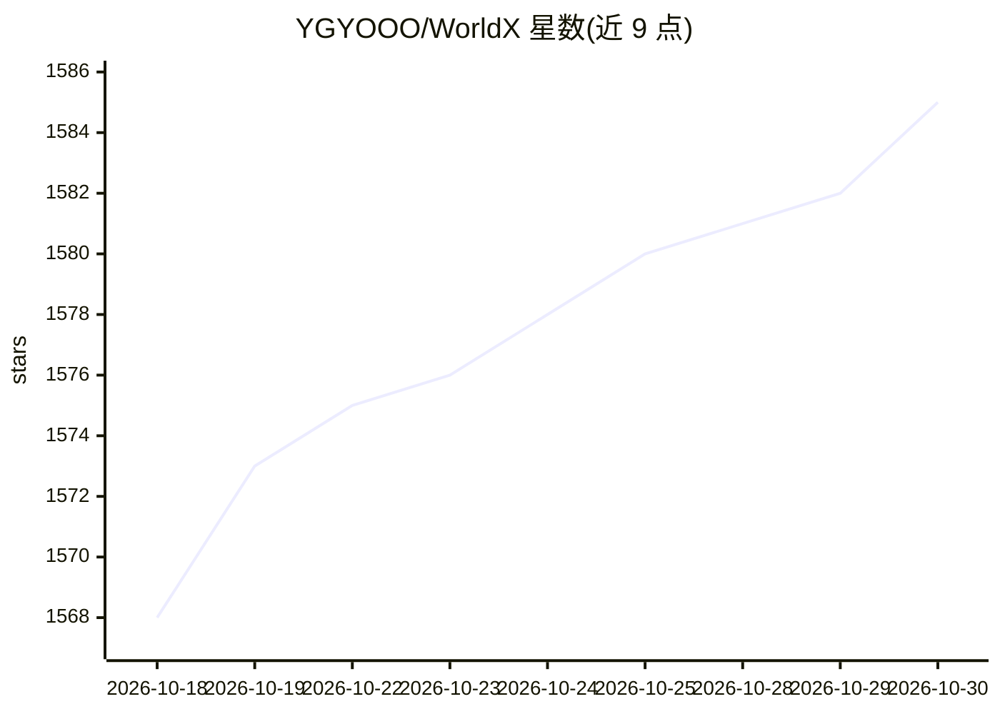

# YGYOOO/WorldX

⭐ 1,585 · TypeScript · MIT · 推送 2026-10-14 · [GitHub](https://github.com/YGYOOO/WorldX) · 个人维护 · 中文 README

**一句话生成 LLM 驱动的 AI 自主世界模拟应用**

面向终端用户的虚拟世界生成与模拟工具：用户输入一句话，由 4 个 LLM 角色（编排引擎、绘图模型、绘图审查、世界驱动）生成地图与角色，之后 AI 角色自主决策、交互、记忆并涌现故事；支持上帝模式介入与多时间线。技术栈为 Node.js 22.13+/TypeScript/React 19/Phaser 3，数据库用 Node 内置 SQLite 无需编译原生模块。模型需自备 API Key（OpenAI 兼容协议），项目自述处于 Alpha 阶段。

## 筛选速览

| 维度 | 判定 | 备注 |
|---|---|---|
| AI 角色 | `ai-native` | 本体是模型或模型工具 |
| 许可风险 | `permissive` | MIT |
| 部署形态 | `library` | 以包/库形式分发 |
| 模型依赖 | locked-api |  |
| 硬件要求 | — | 无带数字的原话,不猜 |
| 安装摩擦 | `low` | 无编译、无系统依赖或容器化 |
| 成熟度 | `idea` | |

## 能力要点

- 一句话生成地图与角色，非模板拼接
- 角色自主决策、记忆与人格、多日演化
- 上帝模式：注入事件、编辑角色记忆/人设、架空对话
- 4 个独立可配的模型角色，支持 OpenRouter/Google AI Studio/混合搭配

## 适用场景

- 输入一句话生成像素风 AI 世界并观察故事涌现
- 以上帝身份干预世界走向或与角色对话
- 用不同时间线探索同一世界的不同发展

## 场景标签

`多智能体` · 领域:Agent 开发

## 证据(README 行号)

> L17: 说出你的要求，**WorldX** 会为你构筑一个完整的虚拟世界。
> L18: AI 角色们会在这个世界里自主生活：他们做决策、与场景交互、建立关系、开展对话、记忆并思考，涌现出没人提前写好剧本的故事。
> L41: - **自主 Agent 驱动** —— 生成的世界中，角色自主决策、建立关系、展开对话

## 星数曲线

2026-10-18 1,568 → 2026-10-30 1,585（+17）

---
*卡片 v1 · prompt 1.4 · 生成 2026-10-21 · 置信度 high · 依据 README sha `7b016a80e541` · [字段定义](../../DATASET.md)*
