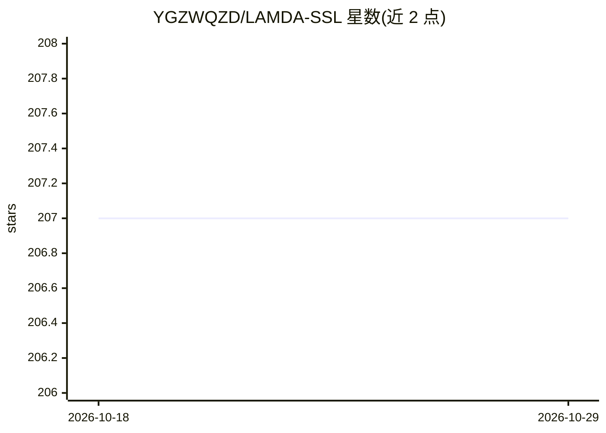

# YGZWQZD/LAMDA-SSL

⭐ 207 · Python · MIT · 推送 2026-03-01 · [GitHub](https://github.com/YGZWQZD/LAMDA-SSL) · 组织维护 · 中文 README

**面向研究者的 Python 半监督学习工具包：30 种 SSL 算法统一框架**

由南京大学 LAMDA 实验室开发的半监督学习工具包，集成 12 种统计机器学习 SSL 算法与 18 种深度学习 SSL 算法于统一框架，覆盖分类、回归、聚类三类任务，处理表格、图像、文本、图四类数据，并含 45 种数据处理方法与 16 种评估指标。接口风格兼容 scikit-learn，深度部分基于 PyTorch，支持 GPU 加速、分布式训练、Pipeline 机制与 5 种超参搜索方法（含贝叶斯优化、元学习器）。以 pip/conda/源码方式安装，附有配套 arXiv 论文与用户文档。

## 筛选速览

| 维度 | 判定 | 备注 |
|---|---|---|
| AI 角色 | `ai-native` | 本体是模型或模型工具 |
| 许可风险 | `permissive` | MIT |
| 部署形态 | `library` | 以包/库形式分发 |
| 模型依赖 | — | README 未给出锁定关系 |
| 硬件要求 | — | 无带数字的原话,不猜 |
| 安装摩擦 | `medium` | 含编译或系统依赖之一 |
| 成熟度 | — | 结构信号不足 |

## 能力要点

- 30 种 SSL 算法（12 统计 + 18 深度）统一实现框架
- 覆盖 4 类数据、3 类任务、45 种数据处理方法、16 种评估指标
- 兼容 scikit-learn 接口，支持 Pipeline 与 5 种超参搜索
- 支持 GPU 加速与分布式训练

## 适用场景

- 标注数据不足时用半监督方法训练分类/回归/聚类模型
- 在统一框架下对比多种 SSL 算法性能
- 复现或扩展半监督学习研究方法

## 场景标签

`模型训练` · 领域:训练与推理

## 证据(README 行号)

> L7: In order to promote the research and application of semi-supervised learning (SSL) algorithms, we have developed LAM
> L9: At present, LAMDA-SSL has implemented 30 SSL algorithms, including 12 statistical SSL algorithms and 18 deep SSL alg
> L191:  LAMDA-SSL is developed by LAMDA@NJU. Contributors are Lin-Han Jia, Lan-Zhe Guo, Zhi Zhou and Yu-Feng Li.

## 星数曲线

2026-10-18 207 → 2026-10-29 207（+0）

---
*卡片 v1 · prompt 1.4 · 生成 2026-10-22 · 置信度 high · 依据 README sha `f29325ff3cad` · [字段定义](../../DATASET.md)*
