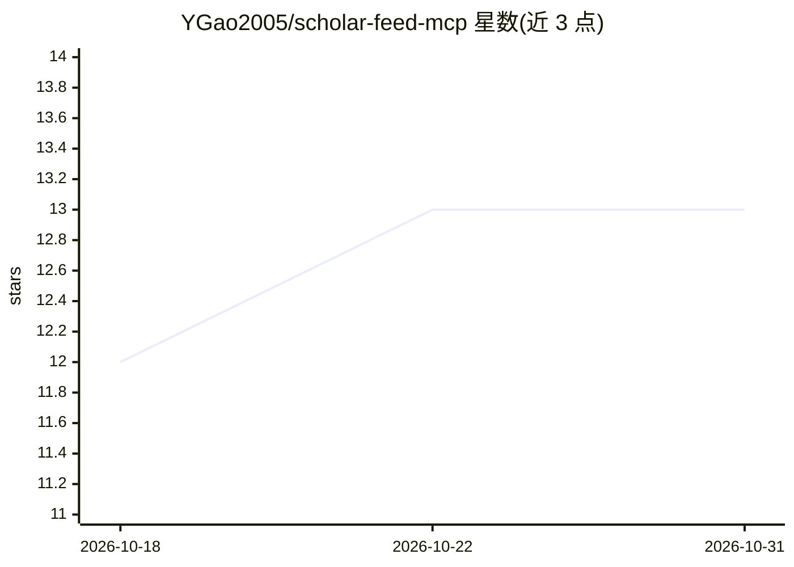

# YGao2005/scholar-feed-mcp

⭐ 13 · TypeScript · MIT · 推送 2026-10-20 · [GitHub](https://github.com/YGao2005/scholar-feed-mcp) · [官网](https://www.scholarfeed.org) · 个人维护

**MCP 论文检索服务器：60万+ CS/AI 论文搜索与引文图谱**

面向 Claude Code、Cursor 等任意 MCP 客户端的 stdio 服务器，提供 27 个工具：语义/关键词论文搜索（按相关性、被引数、趋势排序）、引文图谱（2200万+ 边、正向/反向溯源）、按章节读全文、BibTeX 导出、作者发现、领域定向报告、方法过时检查等。索引 60 万+ arXiv CS/AI 论文，每日更新，每篇含 LLM 生成的摘要与新颖度评分（0-1）。匿名可用（200 次/月），免费 key 提升至 500 次/月并解锁收藏夹、监控等账户功能；embed_text 与 find_gaps 为 Pro 专属。npx 一条命令安装，自动检测客户端写配置。

## 筛选速览

| 维度 | 判定 | 备注 |
|---|---|---|
| AI 角色 | `ai-ecosystem` | LLM/agent 周边工具 |
| 许可风险 | `permissive` | MIT |
| 部署形态 | `library` | 以包/库形式分发 |
| 模型依赖 | — | README 未给出锁定关系 |
| 硬件要求 | — | 无带数字的原话,不猜 |
| 安装摩擦 | `low` | 无编译、无系统依赖或容器化 |
| 成熟度 | — | 结构信号不足 |

## 能力要点

- 27 个工具：搜索、引文图谱、分章节全文、BibTeX、作者图谱、领域定向
- 600k+ CS/AI 论文索引，每日更新，附 LLM 新颖度评分
- 匿名可用（200 次/月），标准 stdio MCP 协议适配多种客户端
- API key 解锁收藏夹、集合、每日评估的 saved search 与缺口分析

## 适用场景

- 在 Claude Code/Cursor 里直接做文献综述与相似论文发现
- 追踪某方向每周趋势与新增论文（watches 每日评估）
- 通过引文图谱回溯某篇论文的方法源头
- 按新颖度阈值过滤出领域内的实质性新工作

## 场景标签

`科研工具` `语义搜索` · 领域:知识与检索

## 证据(README 行号)

> L11: Research paper search with ranking and citation tracking, for LLM engineering and academic research, without leavin
> L136: Scholar Feed is a standard stdio MCP server, so any other MCP-compatible client works with the standard block too.
> L138: ## Available Tools (27)

## 星数曲线

2026-10-18 12 → 2026-10-31 13（+1）

---
*卡片 v1 · prompt 1.4 · 生成 2026-10-31 · 置信度 high · 依据 README sha `0486a3863158` · [字段定义](../../DATASET.md)*
