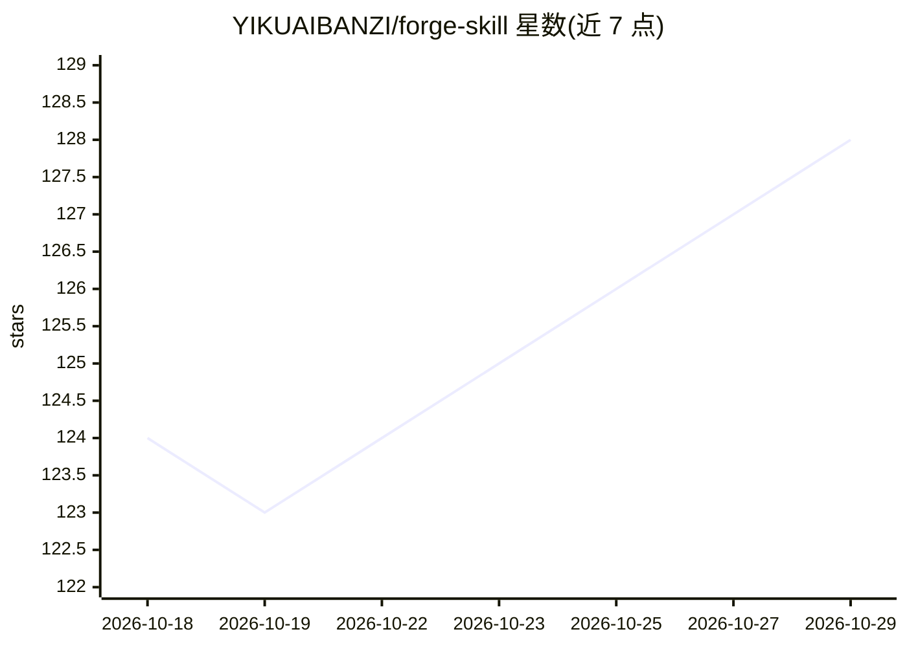

# YIKUAIBANZI/forge-skill

⭐ 128 · Python · MIT · 推送 2026-04-08 · [GitHub](https://github.com/YIKUAIBANZI/forge-skill) · 个人维护 · 中文 README

**本地优先的 Claude Code 人格蒸馏引擎：蒸馏自己与他人**

以 Claude Code Skill 形式提供的人格引擎，包含 4 个命令：forge-self 通过引导式对话、日记、聊天记录等提炼用户自己的说话与决策模式，生成数字替身；forge-persona 从微信聊天记录等材料中蒸馏他人的语气与互动方式；use-self 生成多个参数不同的替身开决策会议，摊开在意点、代价与盲区；use-persona 载入人格档案进行记忆驱动的角色对话。所有解析与人格生成在本地完成，不依赖服务器；README 声明仅用于个人记忆与情感疗愈，禁止用于骚扰、跟踪或侵犯隐私。通过 git clone 到 .claude/skills 安装。

## 筛选速览

| 维度 | 判定 | 备注 |
|---|---|---|
| AI 角色 | `ai-native` | 本体是模型或模型工具 |
| 许可风险 | `permissive` | MIT |
| 部署形态 | `library` | 以包/库形式分发 |
| 模型依赖 | locked-api |  |
| 硬件要求 | — | 无带数字的原话,不猜 |
| 安装摩擦 | `low` | 无编译、无系统依赖或容器化 |
| 成熟度 | — | 结构信号不足 |

## 能力要点

- forge-self / forge-persona / use-self / use-persona 四个 skill，覆盖人格的构建与使用
- 支持微信聊天记录解析（.txt/.html），与对话数据交叉验证并标注置信度
- 人格构建与使用分离，输出结构化人格档案，支持版本管理与纠正层迭代修正
- local-first：数据本地处理与存储，无需服务器

## 适用场景

- 从自己的聊天记录和日记中提炼人格底座，做自我反思与决策辅助
- 留住亲友的说话腔调与互动方式，进行记忆驱动的角色对话
- 在具体决策场景生成多个变体替身，从第三视角看清在意点与盲区

## 场景标签

`提示工程` `Agent 记忆` · 领域:Agent 开发

## 证据(README 行号)

> L15: Forge 是一个 **local-first 的 Claude Code 人格引擎**。
> L18: - **forge-self**：蒸馏你自己的说话方式、决策模式和盲区，生成一个能帮你重新看清自己的数字替身。
> L19: - **forge-persona**：从聊天记录、记忆和描述中蒸馏他人的语气、习惯和互动方式，让 ta 的腔调被近似保留下来。
> L243: /use-persona 小明        # 以小明的方式和你对话

## 星数曲线

2026-10-18 124 → 2026-10-29 128（+4）

---
*卡片 v1 · prompt 1.4 · 生成 2026-10-23 · 置信度 mid · 依据 README sha `bac4df42fba7` · [字段定义](../../DATASET.md)*
