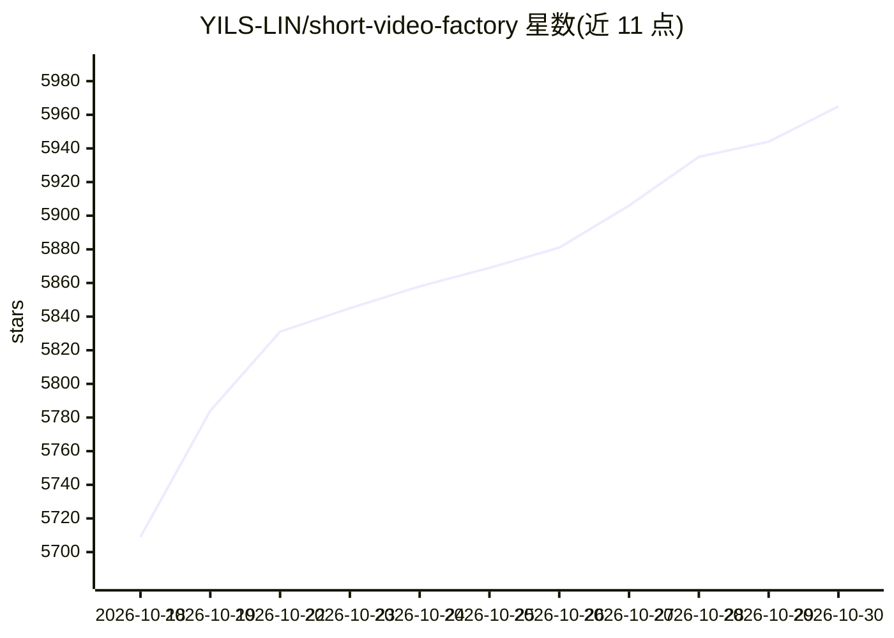

# YILS-LIN/short-video-factory

⭐ 5,965 · TypeScript · AGPL-3.0 · 推送 2026-10-28 · [GitHub](https://github.com/YILS-LIN/short-video-factory) · [官网](https://short-video-factory.yils.blog) · 个人维护 · 中文 README

**一键生成产品营销短视频的跨平台桌面工具**

开源桌面端应用，面向短视频创作者：用户输入提示词文本与视频分镜素材，自动完成文案生成、语音合成（EdgeTTS）、视频剪辑、字幕特效与批量合成，输出产品营销或泛内容短视频。文案生成兼容通用 OpenAI 接口格式，宣称本地化运行以保障数据安全。安装方式为从 GitHub Release 下载安装包，另提供官方文档与微信交流群。字幕特效样式与更多语音合成 API 仍在路线图中。

## 筛选速览

| 维度 | 判定 | 备注 |
|---|---|---|
| AI 角色 | `ai-native` | 本体是模型或模型工具 |
| 许可风险 | `viral` | AGPL-3.0 |
| 部署形态 | `None` |  |
| 模型依赖 | — | README 未给出锁定关系 |
| 硬件要求 | — | 无带数字的原话,不猜 |
| 安装摩擦 | `low` | 无编译、无系统依赖或容器化 |
| 成熟度 | — | 结构信号不足 |

## 能力要点

- 提示词+分镜素材自动生成文案并合成视频
- 语音合成基于 EdgeTTS，文案生成兼容 OpenAI 接口格式
- 批量任务按预设自动持续合成视频
- 支持 Windows/macOS/Linux，宣称完全本地化运行

## 适用场景

- 为产品快速批量制作营销短视频
- 用提示词和素材自动生成带配音字幕的泛内容视频
- 非专业剪辑用户开箱即用地产出短视频

## 场景标签

`AI 写作` `语音合成` `工作流自动化` · 领域:效率与自动化

## 证据(README 行号)

> L27: 短视频工厂是一个开源的桌面端应用，旨在通过AI技术简化短视频的制作流程。用户可以通过简单的提示词文本+视频分镜素材，快速且自动的剪辑出高质量的产品营销和泛内容短视频。该项目集成了AI驱动的文案生成、语音合成、视频剪辑、字幕特效等功
> L31: - 🤖 **AI驱动**：集成了最新的AI技术，提升视频制作效率和质量

## 星数曲线

2026-10-18 5,709 → 2026-10-30 5,965（+256）

---
*卡片 v1 · prompt 1.4 · 生成 2026-10-20 · 置信度 high · 依据 README sha `9a8153f36aa0` · [字段定义](../../DATASET.md)*
