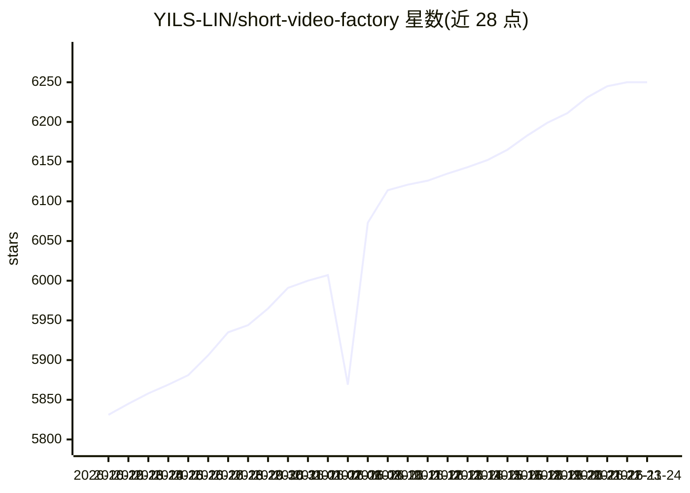

# YILS-LIN/short-video-factory

⭐ 6,265 · TypeScript · AGPL-3.0 · 推送 2026-11-20 · [GitHub](https://github.com/YILS-LIN/short-video-factory) · [官网](https://short-video-factory.yils.blog) · 个人维护 · 中文 README

**给营销/内容创作者一键批量生成短视频的桌面工具**

开源跨平台桌面应用，通过提示词文本加视频分镜素材自动生成短视频：AI 文案生成（兼容 OpenAI 接口格式）、EdgeTTS 语音合成、文案/视频/音频/字幕自动合成剪辑、批量任务按预设持续出片。数据完全本地化运行，支持中文英文等多语言，Windows/macOS/Linux 通过 GitHub Release 安装包获取，配套官方文档使用手册。

## 筛选速览

| 维度 | 判定 | 备注 |
|---|---|---|
| AI 角色 | `ai-native` | 本体是模型或模型工具 |
| 许可风险 | `viral` | AGPL-3.0 |
| 部署形态 | `None` |  |
| 模型依赖 | — | README 未给出锁定关系 |
| 硬件要求 | — | 无带数字的原话,不猜 |
| 安装摩擦 | `low` | 无编译、无系统依赖或容器化 |
| 成熟度 | — | 结构信号不足 |

## 能力要点

- AI 文案生成，兼容通用 OpenAI 接口格式
- EdgeTTS 语音合成与文案/视频/音频/字幕自动合成
- 批量任务按预设自动持续合成视频
- 完全本地化运行，支持 Windows/macOS/Linux

## 适用场景

- 批量产出产品营销短视频
- 自动混剪生成语录类泛内容视频
- 为文案自动配上语音、字幕和特效

## 场景标签

`AI 写作` `语音合成` `视频生成` · 领域:内容生成

## 证据(README 行号)

> L33: 短视频工厂是一个开源的桌面端应用，旨在通过AI技术简化短视频的制作流程。用户可以通过简单的提示词文本+视频分镜素材，快速且自动的剪辑出高质量的产品营销和泛内容短视频。该项目集成了AI驱动的文案生成、语音合成、视频剪辑、字幕特效等功
> L37: - 🤖 **AI驱动**：集成了最新的AI技术，提升视频制作效率和质量
> L91: - [x] 文案生成，兼容通用的 OpenAI 接口格式

## 星数曲线

2026-10-22 5,831 → 2026-11-24 6,250（+419）

---
*卡片 v1 · prompt 1.4 · 生成 2026-11-22 · 置信度 high · 依据 README sha `22c18318df8f` · [字段定义](../../DATASET.md)*
