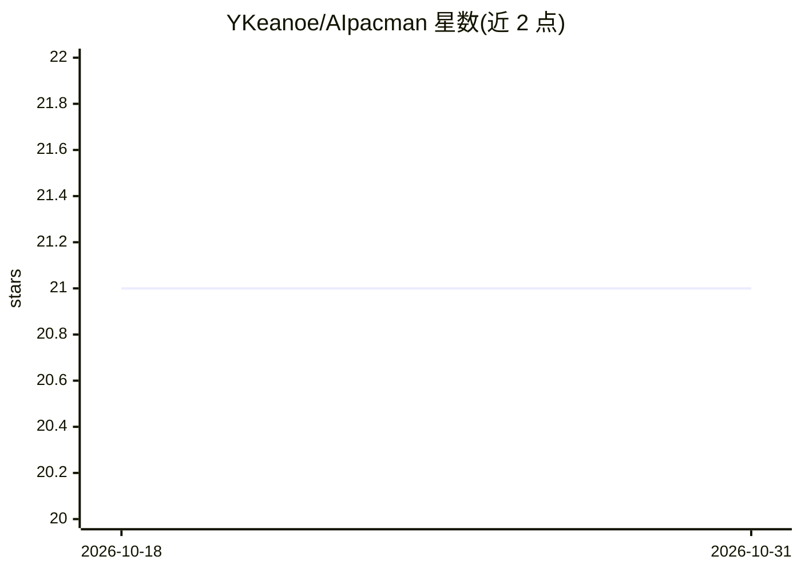

# YKeanoe/AIpacman

⭐ 21 · Python · 推送 2026-01-31 · [GitHub](https://github.com/YKeanoe/AIpacman) · 个人维护

**UC Berkeley Pacman 课程项目：实现搜索与强化学习算法**

作者的三年级人工智能课程作业，按 UC Berkeley Pacman Project 的 project 1-3 实现。包含 DFS、BFS、一致代价搜索、A* 及启发式等寻路算法，Minimax、Alpha-Beta、Expectiminimax 博弈树 Agent，以及值迭代、Q-Learning、Epsilon-Greedy、近似 Q-Learning 等强化学习方法。以 Python 编写，使用 PyCharm 开发。README 未提供安装运行说明，仅列算法清单与展示占位。

## 筛选速览

| 维度 | 判定 | 备注 |
|---|---|---|
| AI 角色 | `ai-native` | 本体是模型或模型工具 |
| 许可风险 | `none` | — |
| 部署形态 | `None` |  |
| 模型依赖 | — | README 未给出锁定关系 |
| 硬件要求 | — | 无带数字的原话,不猜 |
| 安装摩擦 | `low` | 无编译、无系统依赖或容器化 |
| 成熟度 | — | 结构信号不足 |

## 能力要点

- 实现 DFS/BFS/UCS/A* 四种寻路算法
- Minimax、Alpha-Beta、Expectiminimax 博弈 Agent
- 值迭代与 Q-Learning 系列强化学习算法（含近似 Q-Learning）

## 适用场景

- 学习经典搜索与强化学习算法的实现方式
- 作为 UC Berkeley Pacman 课程的参考实现

## 场景标签

`强化学习` · 领域:训练与推理

## 证据(README 行号)

> L4: A project for my third year Artificial Intelegent course. The project follows UC Berkeley Pacman Project from projec
> L15: * Q-Learning Algorithm

## 星数曲线

2026-10-18 21 → 2026-10-31 21（+0）

---
*卡片 v1 · prompt 1.4 · 生成 2026-10-28 · 置信度 high · 依据 README sha `def6d012b5c0` · [字段定义](../../DATASET.md)*
