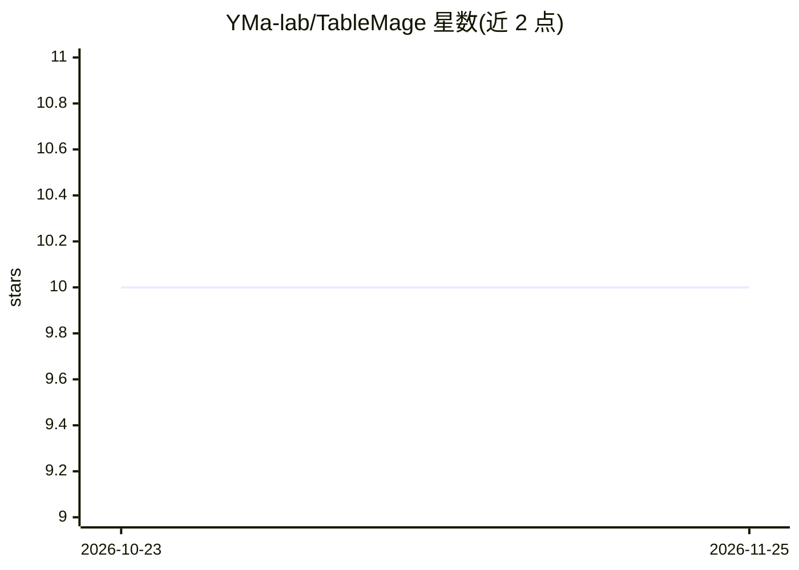

# YMa-lab/TableMage

⭐ 10 · Python · BSD-3-Clause · 推送 2026-04-27 · [GitHub](https://github.com/YMa-lab/TableMage) · [官网](https://tablemage.readthedocs.io) · 组织维护

**临床表格数据的低代码/对话式数据科学 Python 库**

面向临床数据的 Python 包，提供低代码与对话两种方式快速探索表格数据集、执行回归分析、基准测试机器学习模型。其对话入口 ChatDA 是基于工具调用的语言模型 agent，相关论文发表于 npj Artificial Intelligence 并有 medRxiv 预印本。安装要求 Python 3.12 并建议虚拟环境，macOS 首次使用需通过 Homebrew 安装依赖 libomp，当前处于 v0.1.0 发布前的开发阶段。

## 筛选速览

| 维度 | 判定 | 备注 |
|---|---|---|
| AI 角色 | `ai-native` | 本体是模型或模型工具 |
| 许可风险 | `permissive` | BSD-3-Clause |
| 部署形态 | `library` | 以包/库形式分发 |
| 模型依赖 | — | README 未给出锁定关系 |
| 硬件要求 | — | 无带数字的原话,不猜 |
| 安装摩擦 | `low` | 无编译、无系统依赖或容器化 |
| 成熟度 | `idea` | |

## 能力要点

- 低代码/对话式两种方式探索临床表格数据
- 回归分析与机器学习模型基准测试
- ChatDA agent 论文发表于 npj Artificial Intelligence
- alpha 版已发布至 PyPI

## 适用场景

- 快速探索临床表格数据集的结构与统计特征
- 在临床数据上跑回归分析
- 对多个机器学习模型做基准比较

## 场景标签

`数据分析` `模型评测` · 领域:效率与自动化

## 证据(README 行号)

> L9: TableMage is a Python package for low-code/conversational clinical data science.
> L12: and effortlessly benchmark machine learning models.
> L47:   title = {Tool-wielding language model-based agent offers conversational exploration of clinical tabular data},

## 星数曲线

2026-10-23 10 → 2026-11-25 10（+0）

---
*卡片 v1 · prompt 1.4 · 生成 2026-11-20 · 置信度 high · 依据 README sha `0f64e9eb8e0f` · [字段定义](../../DATASET.md)*
