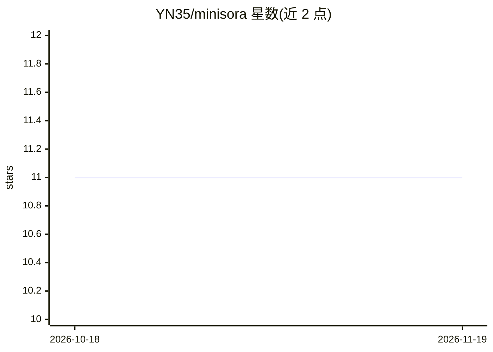

# YN35/minisora

⭐ 11 · Python · MIT · 推送 2025-12-02 · [GitHub](https://github.com/YN35/minisora) · [官网](https://note.com/__ramu0e__/n/ndf8da03ec7f3?sub_rt=share_pb) · 个人维护

**为研究/学习者提供 OpenAI Sora 训练流程的最小 PyTorch 复现**

以 PyTorch 重新实现 OpenAI Sora（DiT，扩散 Transformer）的训练过程，代码定位为可读、可改的教学向实现，同时通过 ColossalAI 支持多节点多 GPU 训练。模型将视频 latent 作为 patch 序列处理空间与时间注意力，支持文本到视频之外的既有视频续写（latent 空间自回归生成）。推理使用 Diffusers 管线与 Hugging Face 预训练权重（minisora-dmlab 已发布，minecraft 待发布），依赖 uv 管理依赖、Docker 提供可复现训练环境，训练经 torchrun 启动。

## 筛选速览

| 维度 | 判定 | 备注 |
|---|---|---|
| AI 角色 | `ai-native` | 本体是模型或模型工具 |
| 许可风险 | `permissive` | MIT |
| 部署形态 | `self-host` | docker 或自建部署 |
| 模型依赖 | — | README 未给出锁定关系 |
| 硬件要求 | — | 无带数字的原话,不猜 |
| 安装摩擦 | `low` | 无编译、无系统依赖或容器化 |
| 成熟度 | — | 结构信号不足 |

## 能力要点

- DiT 视频 latent 扩散生成，支持空间与时间注意力
- 基于 ColossalAI 的多节点多 GPU 训练
- 视频续写：固定首帧后在 latent 空间自回归生成
- 提供 DMLab（64×64/20帧）与 Minecraft（128×128/20帧）模型与数据下载脚本

## 适用场景

- 复现或修改 DiT 视频生成训练流程
- 在多节点集群上训练视频扩散模型
- 用预训练权重做随机视频生成或视频续写实验

## 场景标签

`视频生成` `模型训练` · 领域:内容生成

## 证据(README 行号)

> L22: **minisora** is a minimalist, educational, yet scalable re-implementation of the training process behind OpenAI's S
> L28:  * **🚀 Scalable Training**: Built on ColossalAI to support multi-node, multi-GPU training out of the box.
> L43: minisora implements a Latent Diffusion Transformer (DiT). It processes video latents as a sequence of patches, hand

## 星数曲线

2026-10-18 11 → 2026-11-19 11（+0）

---
*卡片 v1 · prompt 1.4 · 生成 2026-11-18 · 置信度 high · 依据 README sha `3a2a2d48735b` · [字段定义](../../DATASET.md)*
