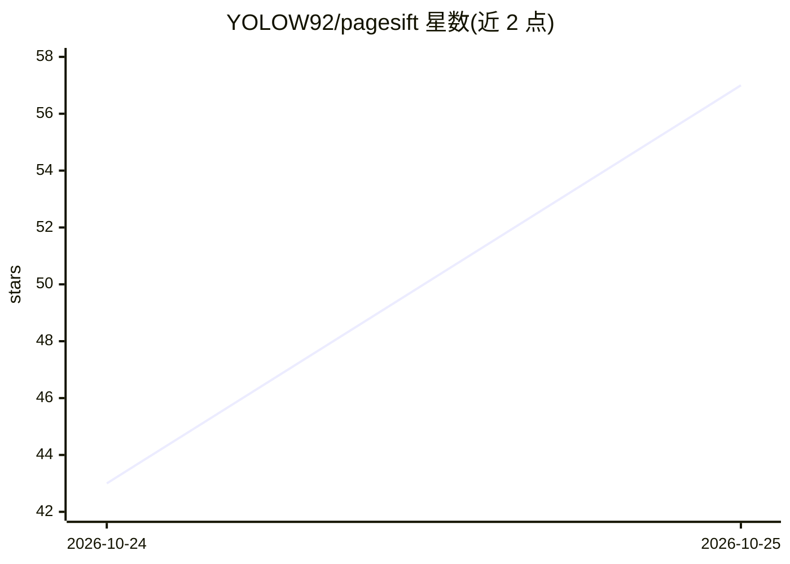

# YOLOW92/pagesift

⭐ 59 · Rust · AGPL-3.0 · 推送 2026-10-25 · [GitHub](https://github.com/YOLOW92/pagesift) · 个人维护 · 中文 README

**面向 AI agent 的 Rust 网页抓取与内容提取引擎**

以单个 Rust 二进制运行的网页/文档抓取与提取引擎，将网站、PDF 与归档转为 Markdown 与结构化数据，供 AI agent 与 LLM 流水线使用。提供 Firecrawl v1/v2 与 Jina Reader 兼容 API、MCP 支持、RAG 分块与 BM25 过滤、隔离 HTTP 会话、有界内存爬取与选择性无头渲染。安装途径含 Docker、pip、npm、cargo。README 中 AGPL-3.0 之外另列 Commercial license 条目。

## 筛选速览

| 维度 | 判定 | 备注 |
|---|---|---|
| AI 角色 | `ai-ecosystem` | LLM/agent 周边工具 |
| 许可风险 | `dual` | AGPL-3.0 |
| 部署形态 | `self-host` | docker 或自建部署 |
| 模型依赖 | — | README 未给出锁定关系 |
| 硬件要求 | — | 无带数字的原话,不猜 |
| 安装摩擦 | `low` | 无编译、无系统依赖或容器化 |
| 成熟度 | — | 结构信号不足 |

## 能力要点

- Firecrawl v1/v2 与 Jina Reader API 兼容，可替换现有 SDK 端点
- RAG 分块与 BM25 查询过滤（19.7 ms / 1.35 ms）
- 分段有界爬取队列与自适应并发（min(CPU, RAM, FD)）
- 选择性无头 Chrome 渲染与 SSRF/沙箱防护

## 适用场景

- 为 RAG 管线批量抓取网页并转为 Markdown
- 用现有 Firecrawl/Jina 客户端接入本地自托管实例
- LLM agent 通过 MCP 或 SSE 流式获取网页内容

## 场景标签

`网页抓取` `文档解析` · 领域:效率与自动化

## 证据(README 行号)

> L5: **High-performance, memory-bounded web scraping and extraction engine built for AI agents and LLM pipelines.**
> L66: - 🌐 **Dual-Protocol Firecrawl v1 & v2 Architecture**: Drop-in compatibility with official Firecrawl Python and Node

## 星数曲线

2026-10-24 43 → 2026-10-25 57（+14）

---
*卡片 v1 · prompt 1.4 · 生成 2026-10-24 · 置信度 high · 依据 README sha `29ce179ec9ea` · [字段定义](../../DATASET.md)*
