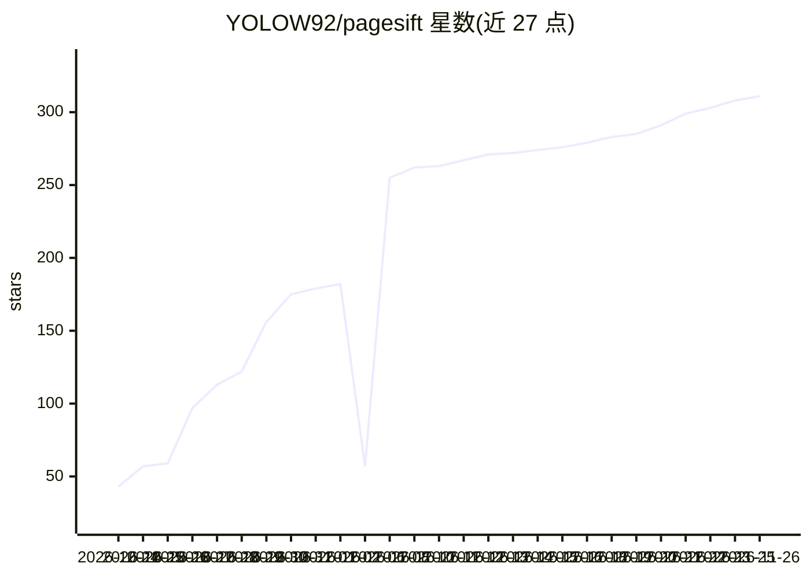

# YOLOW92/pagesift

⭐ 311 · Rust · Apache-2.0 · 推送 2026-11-23 · [GitHub](https://github.com/YOLOW92/pagesift) · [官网](https://pagesift.tech) · 个人维护

**给 AI 应用做本地网页/文档摄取的 Rust 引擎**

单二进制 Rust 自托管数据摄取引擎：将网页、二进制文档、归档与长期监控源转为 Markdown、schema JSON、带来源追踪的 DataGraph、按预算编译的 ContextPack 与可验证结论。内置 CLI、Firecrawl v1/v2 与 Jina Reader 兼容 HTTP API、MCP 服务器、C ABI 及 Python/Node 原生包。解析、存储、调度全在进程内完成，不依赖 Python/JVM/Node 运行时；浏览器池、GPU OCR 与 LLM 端点仅在配置时接入。

## 筛选速览

| 维度 | 判定 | 备注 |
|---|---|---|
| AI 角色 | `ai-enhanced` | 去掉 AI 部分产品仍成立 |
| 许可风险 | `permissive` | Apache-2.0 |
| 部署形态 | `self-host` | docker 或自建部署 |
| 模型依赖 | — | README 未给出锁定关系 |
| 硬件要求 | — | 无带数字的原话,不猜 |
| 安装摩擦 | `low` | 无编译、无系统依赖或容器化 |
| 成熟度 | — | 结构信号不足 |

## 能力要点

- Firecrawl v1/v2 与 Jina Reader 兼容 API，可直接替换接入
- 原生解析 PDF/Office/OCR/邮件/归档/373 种代码语言，纯 Rust 实现
- MCP 服务器暴露 scrape/crawl/graph/context/resolve/agent 等工具
- CLI、HTTP、MCP、FFI 四类入口 + cargo/pip/npm/docker 多渠道分发

## 适用场景

- 为 RAG 与 agent 应用准备带来源证据的网页/文档语料
- 自托管替代外部抓取 API，本地化数据处理链路
- 长期监控网站变更并增量维护证据图谱与结论

## 场景标签

`网页抓取` `文档解析` · 领域:效率与自动化

## 证据(README 行号)

> L5: **Local-first web & document ingestion engine in Rust — HTTP/browser capture, layout-aware PDF/Office/OCR parsing, p
> L21: `pagesift` turns live web pages, uploaded binary documents, archives, and long-lived monitored sources into clean M
> L23: Drop-in or companion for: **Firecrawl** (self-hosted v1/v2 API), **Jina Reader** (`/r/` and `/s/`), **Crawl4AI**, *

## 星数曲线

2026-10-24 43 → 2026-11-26 311（+268）

---
*卡片 v1 · prompt 1.4 · 生成 2026-11-25 · 置信度 high · 依据 README sha `78ce1f7a7dec` · [字段定义](../../DATASET.md)*
