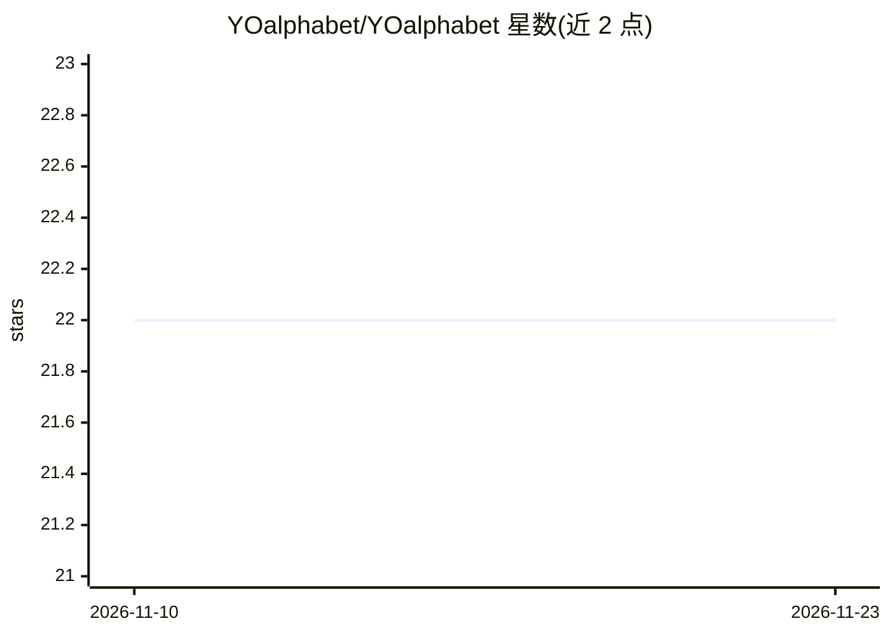

# YOalphabet/YOalphabet

⭐ 22 · HTML · MIT · 推送 2026-11-22 · [GitHub](https://github.com/YOalphabet/YOalphabet) · [官网](https://yoalphabet.github.io/YOalphabet/) · 个人维护

**16 字符的 4-bit 几何文字系统：字形由二进制码生成**

一套人造文字（script）：16 个基础字形，每个字形同时对应一个 4-bit 二进制码、0–15 的十进制值、正方形几何形状和一个 IPA 音素。字形由比特位经布尔运算程序化生成，无需查找表与字体资产。提供 5 元音 11 辅音的音素映射、26 字母英文适配（点修饰符）、Canonical 与 Rotational 两种几何剖面，以及可在浏览器离线运行的在线转换器（可导出 .jpg）和点击游戏。MIT 许可。README 明确声明该系统不做文本识别或解析，仅为编码规范。

## 筛选速览

| 维度 | 判定 | 备注 |
|---|---|---|
| AI 角色 | `ai-enhanced` | 去掉 AI 部分产品仍成立 |
| 许可风险 | `permissive` | MIT |
| 部署形态 | `None` |  |
| 模型依赖 | — | README 未给出锁定关系 |
| 硬件要求 | — | 无带数字的原话,不猜 |
| 安装摩擦 | `low` | 无编译、无系统依赖或容器化 |
| 成熟度 | — | 结构信号不足 |

## 能力要点

- 4-bit 码 ↔ 十进制 ↔ 几何形状 ↔ IPA 音素的一一对应
- 字形由纯布尔运算程序化生成，零查找表、无内嵌字体资产
- 提供 4x4 全字形矩阵作为系统校准标识的空间排版规范
- 实验性标点体系：12 个半元素组合出 435 种可一笔书写形状

## 适用场景

- 在浏览器中输入 0-9 与 A-Z 文本并查看、导出对应字形
- 在微控制器或资源受限显示器上以纯算法渲染字形
- 构造语言/字体设计爱好者研究二进制编码文字体系

## 场景标签

 · 领域:文字/字体设计

## 证据(README 行号)

> L7: # YOalphabet. A 4-Bit Geometric Writing System
> L17: YOalphabet is a script of 16 core glyphs. Each glyph lives in a square, and the four edges of that square are four 
> L39: - **Does it recognize or parse text?** No. Encoding is not understanding: the specification defines glyphs and thei

## 星数曲线

2026-11-10 22 → 2026-11-23 22（+0）

---
*卡片 v1 · prompt 1.4 · 生成 2026-11-18 · 置信度 low · 依据 README sha `14ae834db52f` · [字段定义](../../DATASET.md)*
