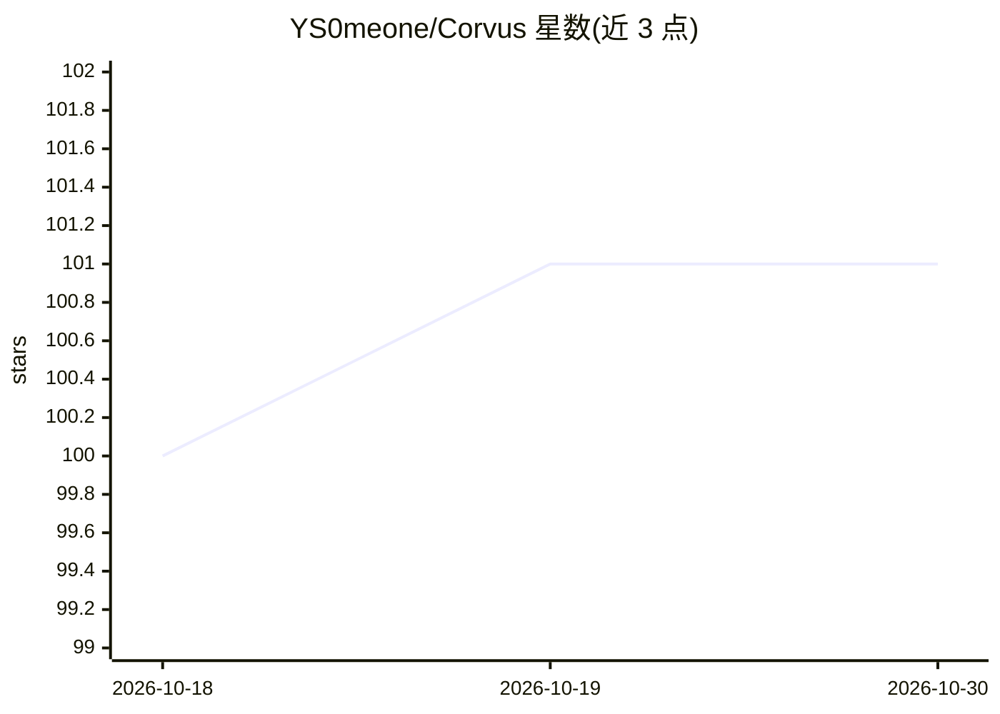

# YS0meone/Corvus

⭐ 101 · Python · MIT · 推送 2026-02-28 · [GitHub](https://github.com/YS0meone/Corvus) · [官网](https://corvus-agent.vercel.app) · 个人维护

**多智能体学术论文检索与问答系统：找论文、引文滚雪球、基于所选论文回答问题**

基于 LangGraph 监督者架构的多智能体研究系统：顶层监督者路由到论文发现智能体（Semantic Scholar 关键词/过滤搜索、Tavily 网络搜索、前向/后向引文滚雪球，Cohere 重排后保留前 35 篇）与问答智能体（对用户选定论文在 Qdrant 上做范围受限的向量检索并合成回答，含证据自评与迭代重检索）。加入论文时经 Celery 后台流水线（arXiv 查找、Grobid 解析、分块嵌入）索引全文，向量库跨用户共享。部署需 OpenAI/Gemini/Cohere/Semantic Scholar API key，通过 Docker Compose 启动 Redis/Qdrant/Grobid，再分别运行 worker、后端与 React 前端；另提供 MCP server 供 Claude Desktop 调用其搜索工具。

## 筛选速览

| 维度 | 判定 | 备注 |
|---|---|---|
| AI 角色 | `ai-native` | 本体是模型或模型工具 |
| 许可风险 | `permissive` | MIT |
| 部署形态 | `self-host` | docker 或自建部署 |
| 模型依赖 | locked-api |  |
| 硬件要求 | — | 无带数字的原话,不猜 |
| 安装摩擦 | `low` | 无编译、无系统依赖或容器化 |
| 成熟度 | — | 结构信号不足 |

## 能力要点

- 监督者+子智能体的 LangGraph 架构，含查询评估、规划、重规划与论文选择中断
- 前向/后向引文滚雪球与 Semantic Scholar 过滤搜索、Cohere 重排
- Q&A 检索范围限定在用户选定论文，含证据充分性评估与迭代重检索
- Celery+Grobid 后台论文摄取流水线，向量库跨用户共享去重

## 适用场景

- 让 AI 帮我按主题查找并筛选相关学术论文
- 对我选定的论文集提问并获得基于原文证据的回答
- 通过引文滚雪球追踪某篇论文的前置与后续工作

## 场景标签

`科研工具` `多智能体` `文档问答` · 领域:Agent 开发

## 证据(README 行号)

> L3: A **multi-agent AI research system** built on a supervisor architecture. A top-level supervisor routes between speci
> L29: Corvus is built around three LangGraph agents: a **Supervisor** that plans and routes, a **Paper Finding Agent** th

## 星数曲线

2026-10-18 100 → 2026-10-30 101（+1）

---
*卡片 v1 · prompt 1.4 · 生成 2026-10-23 · 置信度 high · 依据 README sha `8548deb22ed1` · [字段定义](../../DATASET.md)*
