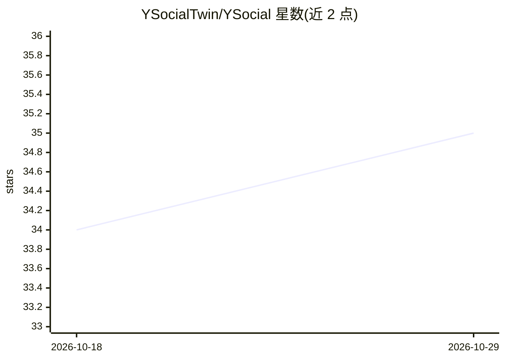

# YSocialTwin/YSocial

⭐ 35 · JavaScript · GPL-3.0 · 推送 2026-10-23 · [GitHub](https://github.com/YSocialTwin/YSocial) · [官网](https://y-not.social) · 组织维护

**面向计算社会科学的社交媒体数字孪生仿真平台（LLM 驱动）**

零代码创建、配置并运行社交媒体仿真的平台：LLM 驱动的 agent 与真人用户共用微博客、论坛、图片分享三类模拟平台，可发帖、评论、关注与互动；支持多种推荐系统、agent 人口统计与人格配置。LLM 接入 Ollama、vLLM 或任意 OpenAI 兼容服务器。通过管理面板配置实验，结果可用内嵌 Jupyter Lab 与 ySights 库分析。提供桌面安装器（macOS/Windows/Linux）、pip wheel、Docker 镜像与源码四种安装方式；核心加插件架构，GPL v3 许可。

## 筛选速览

| 维度 | 判定 | 备注 |
|---|---|---|
| AI 角色 | `ai-native` | 本体是模型或模型工具 |
| 许可风险 | `viral` | GPL-3.0 |
| 部署形态 | `desktop` | 安装包/桌面程序 |
| 模型依赖 | local-ok | 支持本地模型 |
| 硬件要求 | — | 无带数字的原话,不猜 |
| 安装摩擦 | `low` | 无编译、无系统依赖或容器化 |
| 成熟度 | — | 结构信号不足 |

## 能力要点

- 微博客/论坛/图片分享三类模拟平台，各带多种推荐系统
- LLM agent 与真人混合互动（human-in-the-loop）
- 接入 Ollama、vLLM 或任意 OpenAI 兼容服务器
- 实验级内嵌 Jupyter Lab 与 ySights 分析库，插件化架构

## 适用场景

- 研究社交动态与平台设计选择对在线社区的影响
- 在不真实平台上不现实或不伦理的场景下做社会实验
- 做含真人参与的人机混合社交网络仿真并分析结果

## 场景标签

`多智能体` `推荐系统` · 领域:Agent 开发

## 证据(README 行号)

> L21: YSocial lets you **create, configure and run social media simulations** in a zero-code environment. AI-driven agent
> L77: - **LLM integration**: Ollama, vLLM or any OpenAI-compatible server, with different models for different population

## 星数曲线

2026-10-18 34 → 2026-10-29 35（+1）

---
*卡片 v1 · prompt 1.4 · 生成 2026-10-25 · 置信度 high · 依据 README sha `1fe8a684740d` · [字段定义](../../DATASET.md)*
