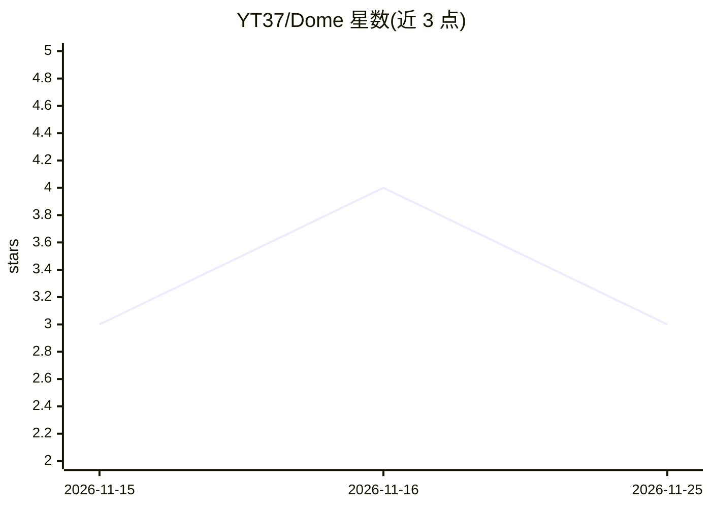

# YT37/Dome

⭐ 3 · Python · MIT · 推送 2026-11-23 · [GitHub](https://github.com/YT37/Dome) · [官网](https://dome.surf) · 个人维护

**面向反拐调查团队的六 Agent 线索生成工具**

Dome 是一个针对信任与安全团队、反拐 NGO 和警方拐卖部门的调查工具：六个 Agent 在 LangChain deepagents 监督者下协作，从可疑社交账号中串出团伙、追踪其资金链，并将照片定位到建筑与房间层级。所有数据为合成数据，不抓取真实账号。关键机制包括：代码强制校验每条规则（数字由代码产出，AI 只写文字）、置信度阈值分级（High 需 P/W/R 全达标）、审计日志 log.jsonl。输出仅为供人工核验的线索，不提供地址、不证明任何人身处其中。

## 筛选速览

| 维度 | 判定 | 备注 |
|---|---|---|
| AI 角色 | `ai-native` | 本体是模型或模型工具 |
| 许可风险 | `none` | MIT |
| 部署形态 | `library` | 以包/库形式分发 |
| 模型依赖 | — | README 未给出锁定关系 |
| 硬件要求 | — | 无带数字的原话,不猜 |
| 安装摩擦 | `low` | 无编译、无系统依赖或容器化 |
| 成熟度 | — | 结构信号不足 |

## 能力要点

- 六个 Agent 流水线：Spotter→Linker→Zoner→Lister→Locator→Briefer，各写出结构化 JSON 与 HTML 简报
- 代码强制护栏：write_brief_text 拒绝简报中不存在于证据中的数字、街址或电话号码
- 照片定位使用 DINOv2 相似度初筛 + DISK+LightGlue 特征匹配 + RANSAC，阈值 50
- 拓扑二次意见：证据转为组合复形，UniGCN (TopoModelX) 对每个账号给出入环概率

## 适用场景

- 反拐调查中把多个广告账号串成同一团伙并追踪资金角色
- 将广告照片缩小到具体建筑与楼层作为核查线索
- 信托与安全团队对可疑账号做信号交叉筛查
- 以 LangGraph Studio 在本地复跑和检查整条 Agent 流水线

## 场景标签

`多智能体` · 领域:Agent 开发

## 证据(README 行号)

> L13: Dome is an investigation tool for trust and safety teams, anti-trafficking NGOs and police
> L14: trafficking units. Six agents under one LangChain **deepagents** supervisor pick out suspicious
> L27:  How it works. Six agents, each with its input, what it did, its output file and the real number: 15 flagged → 1 ri

## 星数曲线

2026-11-15 3 → 2026-11-25 3（+0）

---
*卡片 v1 · prompt 1.4 · 生成 2026-11-21 · 置信度 high · 依据 README sha `efcbb92363c9` · [字段定义](../../DATASET.md)*
