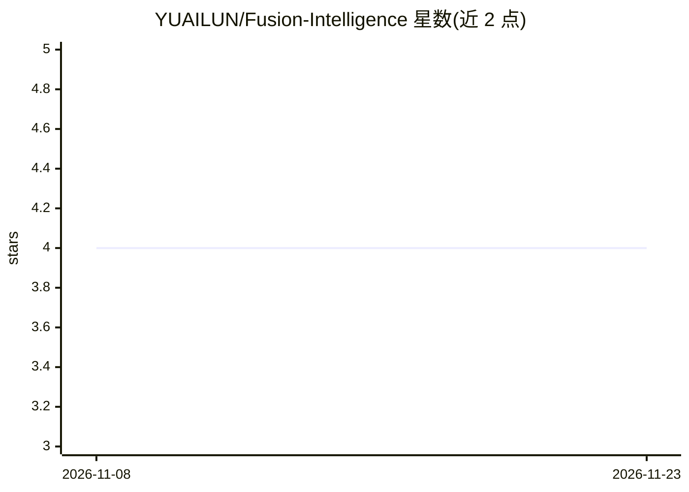

# YUAILUN/Fusion-Intelligence

⭐ 4 · Python · MIT · 推送 2026-10-15 · [GitHub](https://github.com/YUAILUN/Fusion-Intelligence) · 个人维护 · 中文 README

**为科研工作提供多视角独立推理融合的 Agent 技能**

一个面向 Claude Code、Codex 与 Antigravity 的 Agent Skill：将一个研究问题交给 6–16 个独立推理视角（lens）并附带红队，先建立带 [E#] 标注的证据台账，再按共识/争议/单视角假设/盲点/回声分类声明，输出校准置信度、分歧的 crux 类型与解决路径，以及无遗憾行动与可证伪检验。支持 quick/standard/deep/pantheon 四种规模模式，通过 SKILL.md 或 AGENTS.md 加载，附校验脚本。定位为科研设计、申请书预审、稿件评审等场景的结构化二次意见，明确声明不提供独立专业性与数据。

## 筛选速览

| 维度 | 判定 | 备注 |
|---|---|---|
| AI 角色 | `ai-native` | 本体是模型或模型工具 |
| 许可风险 | `permissive` | MIT |
| 部署形态 | `library` | 以包/库形式分发 |
| 模型依赖 | — | README 未给出锁定关系 |
| 硬件要求 | — | 无带数字的原话,不猜 |
| 安装摩擦 | `low` | 无编译、无系统依赖或容器化 |
| 成熟度 | — | 结构信号不足 |

## 能力要点

- 独立视角 + 共享证据台账的工作流，区分共识、争议与回声
- 六种 crux 类型的分歧标注与解决路径
- quick/standard/deep/pantheon 四种运行模式，支持并行 agent
- 同时支持 Claude Code、Codex、Antigravity 及读取 SKILL.md/AGENTS.md 的 agent

## 适用场景

- 对研究想法做多视角压力测试
- 课题申请书提交前做评审会式预审
- 量表研制或研究方案按 COSMIN 流程审查
- 为预测模型评估真实世界数据库的适配性

## 场景标签

`科研工具` · 领域:学习与行业

## 证据(README 行号)

> L5: > One research question → a panel of independent reasoning lenses → grounded in evidence → **fused** into a
> L8: An Agent Skill for **Claude Code**, **Codex** and **Antigravity** (and anything that reads `SKILL.md` or
> L37: Modes: `quick` (4 lenses, ≤ 1 page) · `standard` (6–8) · `deep` (10–16 + cross-exam, parallel agents) ·

## 星数曲线

2026-11-08 4 → 2026-11-23 4（+0）

---
*卡片 v1 · prompt 1.4 · 生成 2026-11-21 · 置信度 high · 依据 README sha `cd83905819c0` · [字段定义](../../DATASET.md)*
