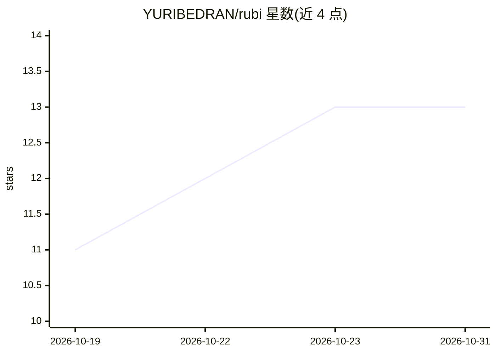

# YURIBEDRAN/rubi

⭐ 13 · JavaScript · MIT · 推送 2026-10-21 · [GitHub](https://github.com/YURIBEDRAN/rubi) · [官网](https://yuribedran.github.io/rubi/) · 个人维护 · 中文 README

**AI 编程助手的上下文管理器：知识图谱+提前压缩降 token 成本**

面向 Claude Code、Codex、Gemini CLI、Cursor、Copilot 等编程 agent 的知识图谱与上下文管理工具，以标准 MCP server 形式运行并支持本地模型。机制包括：提前压缩并在前后保存/恢复 handoff；基于导入关系计算 PageRank 的代码地图；由 Claude 自身充当索引器与语义搜索（无需额外模型/向量库），用 BM25+Personalized PageRank+RRF 混合检索时序知识图谱。数据以纯 markdown 存于项目 .rubi/ 目录，零依赖本地运行，可提交供团队共享。附 token X-ray 分析本地转录，报告对 284 个真实转录的测量结果（≈37% 总成本降低为模拟值）。

## 筛选速览

| 维度 | 判定 | 备注 |
|---|---|---|
| AI 角色 | `ai-ecosystem` | LLM/agent 周边工具 |
| 许可风险 | `permissive` | MIT |
| 部署形态 | `None` |  |
| 模型依赖 | local-ok | 支持本地模型 |
| 硬件要求 | — | 无带数字的原话,不猜 |
| 安装摩擦 | `low` | 无编译、无系统依赖或容器化 |
| 成熟度 | — | 结构信号不足 |

## 能力要点

- 提前压缩 + handoff 保存/恢复，缩短会话
- BM25 + Personalized PageRank + RRF 混合检索的时序知识图谱（决策/bug/陷阱/概念）
- Claude 自身作为索引器与语义搜索，无需额外模型或向量库
- 纯 markdown 存储（.rubi/），零依赖，可作为 Obsidian 图谱打开

## 适用场景

- 降低 AI 编程助手长会话的 token 成本
- 在团队间共享项目的决策与陷阱知识库
- 让每次新会话自动召回相关知识而无需重新探索代码

## 场景标签

`知识图谱` `Agent 记忆` · 领域:Agent 开发

## 证据(README 行号)

> L30: 2. **Make the project easy to find your way around, so less reading is needed.** It builds a **map of the code** (i
> L32: Everything is plain markdown inside the project (`.rubi/`), opens as an Obsidian graph, and runs locally with zero 

## 星数曲线

2026-10-19 11 → 2026-10-31 13（+2）

---
*卡片 v1 · prompt 1.4 · 生成 2026-10-31 · 置信度 high · 依据 README sha `2400b86431b4` · [字段定义](../../DATASET.md)*
