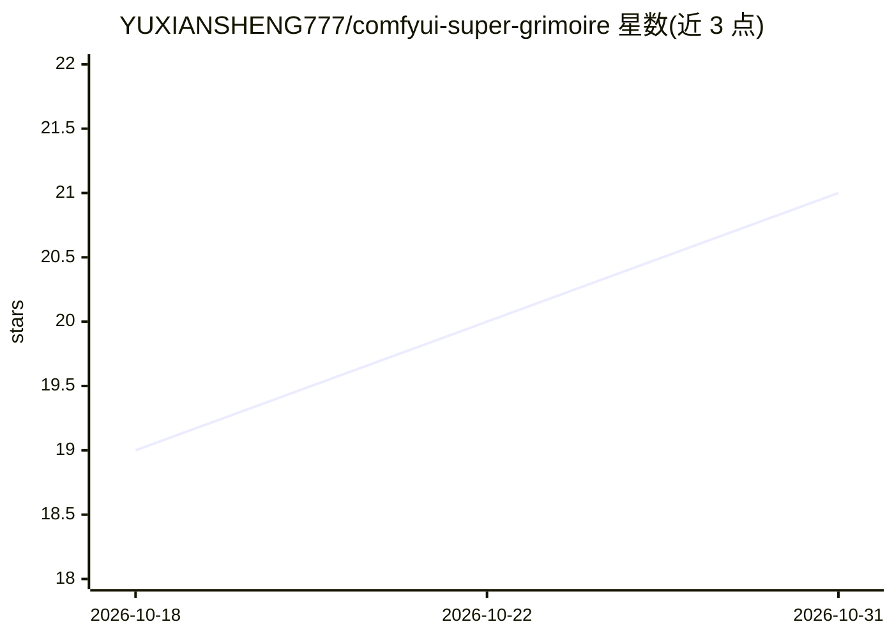

# YUXIANSHENG777/comfyui-super-grimoire

⭐ 21 · HTML · 推送 2026-07-13 · [GitHub](https://github.com/YUXIANSHENG777/comfyui-super-grimoire) · 个人维护 · 中文 README

**AI绘画提示词组合器：标签管理与ComfyUI生图Web前端**

面向 Stable Diffusion / ComfyUI 用户的 Web 工具：内置两套标签库（短语2553条+Danbooru风格2547条）支持浏览、搜索、收藏与随机组合，配权重滑块、模板与负面预设；AI润色支持 OpenAI/LM Studio/Ollama/自定义API，可接入视觉大模型反推生图；通过 API 格式 JSON 工作流对接 ComfyUI 排队生图，并提供相册、回收站、Output文件管理与桌面/手机双端数据同步。Windows + Python 3 环境下运行 start.bat 启动 Flask 服务。

## 筛选速览

| 维度 | 判定 | 备注 |
|---|---|---|
| AI 角色 | `ai-ecosystem` | LLM/agent 周边工具 |
| 许可风险 | `none` | — |
| 部署形态 | `None` |  |
| 模型依赖 | local-ok | 支持本地模型 |
| 硬件要求 | — | 无带数字的原话,不猜 |
| 安装摩擦 | `low` | 无编译、无系统依赖或容器化 |
| 成熟度 | — | 结构信号不足 |

## 能力要点

- 两套标签库（2553条短语+2547条Danbooru风格）三级分类浏览与随机组合
- AI润色支持 OpenAI/LM Studio/Ollama/自定义API，含导演预设与反推生图
- 通过API格式JSON工作流对接ComfyUI：CLIP绑定、参数编辑、GGUF模型选择、队列生图
- 桌面/手机双端，数据经Flask服务端双向同步，附相册与Output文件管理

## 适用场景

- 浏览和随机组合标签，快速搭建AI绘画提示词
- 手机上远程操作电脑的ComfyUI排队生图并浏览返图
- 用大模型润色提示词或反推图片后自动生图
- 管理生图输出的相册、收藏与回收站删除

## 场景标签

`提示工程` `图像生成` · 领域:Agent 开发

## 证据(README 行号)

> L5: 面向 Stable Diffusion / ComfyUI 的标签浏览、随机组合、AI润色、批量生图全功能 Web 工具。桌面/手机双端适配，数据通过 Flask 服务端同步。
> L39: - 支持 OpenAI / LM Studio / Ollama / 自定义 API，配置服务端存储桌面手机共享
> L48: - 工作流管理：API 格式 JSON 放入 `workflows/` 文件夹即可识别

## 星数曲线

2026-10-18 19 → 2026-10-31 21（+2）

---
*卡片 v1 · prompt 1.4 · 生成 2026-10-28 · 置信度 high · 依据 README sha `7b718f794ea4` · [字段定义](../../DATASET.md)*
