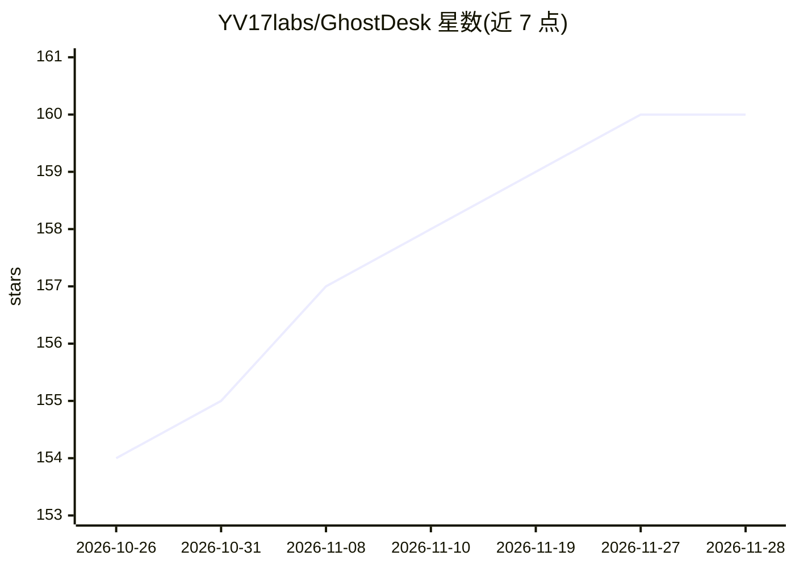

# YV17labs/GhostDesk

⭐ 160 · Rust · NOASSERTION · 推送 2026-11-19 · [GitHub](https://github.com/YV17labs/GhostDesk) · [官网](https://www.yv17labs.com) · 组织维护

**给 AI agent 提供可控虚拟桌面的 MCP 服务器**

一个 MCP 服务器，让 LLM agent 在虚拟桌面（或本机桌面）上看屏幕、移动鼠标、敲键盘、启动应用、执行 shell 命令。提供 14 个工具（截图、鼠标键盘、剪贴板、应用列表/启动），坐标以最后一次截图为基准。Linux 通过 Docker 容器以一次性虚拟桌面沙箱运行，macOS/Windows 以原生二进制驱动真实桌面（无隔离）。README 给出与 Claude Code/Claude Desktop 等 MCP 客户端对接的配置示例，并说明模型需具备视觉、工具调用、MCP 客户端与 WebP 解码能力；本地推理路径推荐 Ollama 配 Qwen 模型。

## 筛选速览

| 维度 | 判定 | 备注 |
|---|---|---|
| AI 角色 | `ai-ecosystem` | LLM/agent 周边工具 |
| 许可风险 | `none` | NOASSERTION |
| 部署形态 | `desktop` | 安装包/桌面程序 |
| 模型依赖 | local-ok | 支持本地模型 |
| 硬件要求 | — | 无带数字的原话,不猜 |
| 安装摩擦 | `low` | 无编译、无系统依赖或容器化 |
| 成熟度 | — | 结构信号不足 |

## 能力要点

- 14 个 verb_noun 命名的 MCP 工具：截图、鼠标键盘操作、剪贴板、应用列表/启动
- Linux 容器内置虚拟桌面（noVNC 浏览器查看），每次 agent 一个可弃置沙箱
- 同一 MCP 端点覆盖 Linux/macOS/Windows 三种桌面，工具面一致
- 模型无关：云模型（Claude/GPT/Gemini）或本地 Ollama 皆可驱动

## 适用场景

- 让 agent 自动操作浏览器、遗留软件、内部工具等有 UI 的一切
- 在一次性沙箱桌面里安全地跑 agent 自动化任务
- 用本地模型驱动桌面自动化，截图不出内网

## 场景标签

`GUI 自动化` · 领域:效率与自动化

## 证据(README 行号)

> L10:  An MCP server that lets LLM agents see the screen, move the mouse, type on the keyboard, launch apps, and run shel
> L72: GhostDesk speaks MCP over the Streamable
> L177: Fourteen tools, named `verb_noun`, and this is the whole surface — no hidden

## 星数曲线

2026-10-26 154 → 2026-11-28 160（+6）

---
*卡片 v1 · prompt 1.4 · 生成 2026-11-27 · 置信度 high · 依据 README sha `59a7383f9f8b` · [字段定义](../../DATASET.md)*
