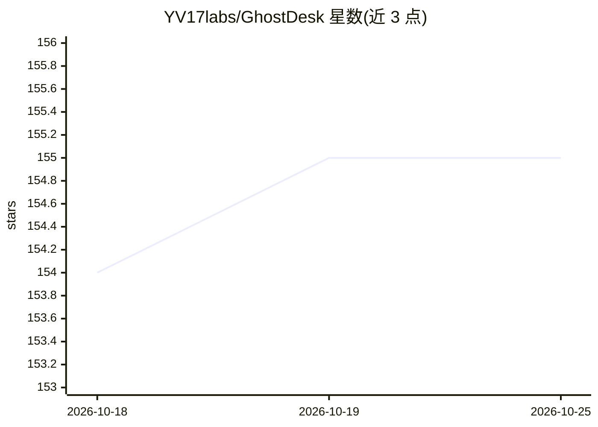

# YV17labs/GhostDesk

⭐ 154 · Rust · NOASSERTION · 推送 2026-09-23 · [GitHub](https://github.com/YV17labs/GhostDesk) · [官网](https://www.yv17labs.com) · 组织维护

**给 AI agent 提供完整桌面控制的 MCP 服务器：看屏幕、点击、打字、跑应用**

Rust 编写的 MCP 服务器，向 LLM agent 暴露 14 个工具（截屏、鼠标键盘、剪贴板、应用列表/启动/状态），通过 Streamable HTTP 传输驱动桌面。Linux 路径以 Docker 容器运行沙箱化虚拟桌面（内含 Firefox、foot 终端等），macOS/Windows 以原生二进制驱动本机桌面、无隔离。模型需具备文本+视觉、工具调用、MCP 客户端与 WebP 解码四项能力；推荐搭配 Ollama 拉取 Qwen 系列模型，也支持云端 Claude/GPT/Gemini。演示模式为无认证明文 HTTP，README 注明仅限本机试用。

## 筛选速览

| 维度 | 判定 | 备注 |
|---|---|---|
| AI 角色 | `ai-ecosystem` | LLM/agent 周边工具 |
| 许可风险 | `none` | NOASSERTION |
| 部署形态 | `desktop` | 安装包/桌面程序 |
| 模型依赖 | local-ok | 支持本地模型 |
| 硬件要求 | — | 无带数字的原话,不猜 |
| 安装摩擦 | `low` | 无编译、无系统依赖或容器化 |
| 成熟度 | — | 结构信号不足 |

## 能力要点

- 14 个 MCP 工具覆盖截屏、鼠标键盘输入、剪贴板、应用启动与状态
- Linux 上单条 Docker 命令运行沙箱化虚拟桌面，含 Firefox 等预装应用
- 三平台同一工具接口：Linux 容器沙箱、macOS/Windows 原生驱动本机桌面
- noVNC 页面（:6080）实时观察 agent 操作虚拟桌面

## 适用场景

- 让 agent 通过截图+点击操作浏览器和仅有 UI 的传统软件
- 在隔离的一次性虚拟桌面中自动化内部工具，无需 API
- 用本地 Ollama + Qwen 模型在本地网络内完成桌面自动化

## 场景标签

`GUI 自动化` `浏览器自动化` · 领域:效率与自动化

## 证据(README 行号)

> L10:  An MCP server that lets LLM agents see the screen, move the mouse, type on the keyboard, launch apps, and run shel
> L179: Fourteen tools, named `verb_noun`, and this is the whole surface — no hidden

## 星数曲线

2026-10-18 154 → 2026-10-25 155（+1）

---
*卡片 v1 · prompt 1.4 · 生成 2026-10-22 · 置信度 high · 依据 README sha `29d325860bca` · [字段定义](../../DATASET.md)*
