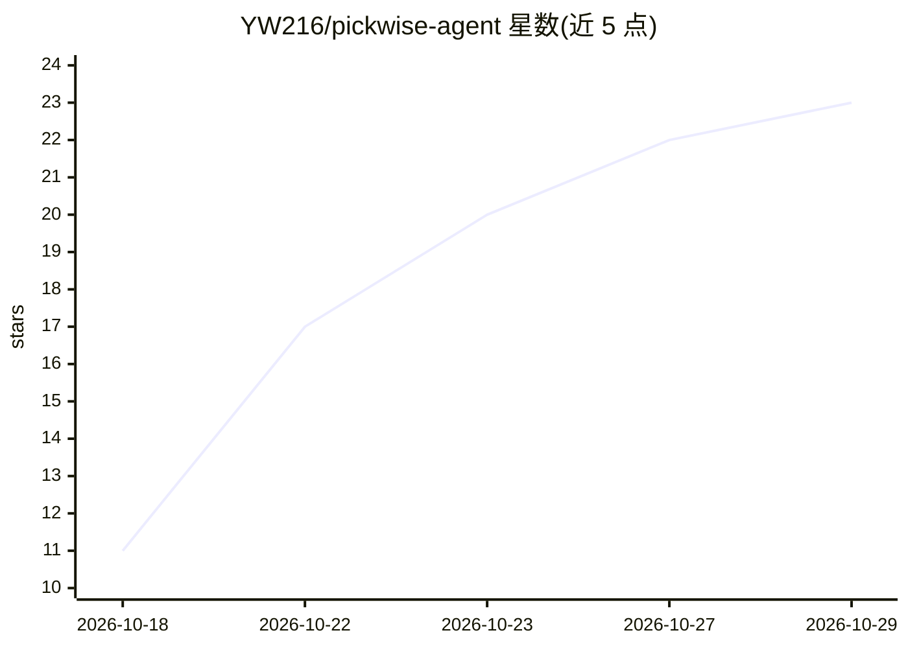

# YW216/pickwise-agent

⭐ 23 · Python · 推送 2026-10-20 · [GitHub](https://github.com/YW216/pickwise-agent) · 个人维护 · 中文 README

**面向消费者的 3C 商品智能选购决策助手（多 Agent 应用）**

PickWise 是一个面向笔记本 / 手机 / 耳机选购的智能决策助手：用户用自然语言描述预算与偏好，系统通过多 Agent 编排（presale / consult，Router 分发 + Blackboard 汇总）、手写 ReAct 循环、工具调用、Milvus+BM25+RRF 混合检索与用户记忆，给出有依据的推荐。不依赖 LangChain / LangGraph，会话管理到工具调用均为自行实现；提供 SSE 过程可视化、多租户隔离、幂等与 231 条可复现评测。技术栈为 Python / FastAPI / React 19 / PostgreSQL / Milvus。

## 筛选速览

| 维度 | 判定 | 备注 |
|---|---|---|
| AI 角色 | `ai-native` | 本体是模型或模型工具 |
| 许可风险 | `none` | — |
| 部署形态 | `self-host` | docker 或自建部署 |
| 模型依赖 | — | README 未给出锁定关系 |
| 硬件要求 | — | 无带数字的原话,不猜 |
| 安装摩擦 | `low` | 无编译、无系统依赖或容器化 |
| 成熟度 | — | 结构信号不足 |

## 能力要点

- 多 Agent 编排：Router 场景路由 + 手写 ReAct 循环 + Blackboard 并行汇总
- 混合检索：Dense(bge-m3) + BM25 + RRF 融合，Milvus 只管召回、PostgreSQL 作真值回查
- 上下文工程：历史工具调用投影、事务式上下文压缩、工具三道闸门与调用熔断
- 多租户隔离：签名 Cookie + CSRF、会话键隔离、Idempotency-Key 请求幂等

## 适用场景

- 用自然语言描述预算和用途，获得有依据的 3C 商品推荐
- 咨询商品参数、售后政策与选购知识
- 对比候选商品并查看 AI 推荐过程的实时展示

## 场景标签

`多智能体` `RAG` · 领域:Agent 开发

## 证据(README 行号)

> L24: **PickWise** 是一个面向 3C 商品（笔记本 / 手机 / 耳机）选购的智能决策助手。用户用自然语言描述预算、用途和偏好，系统会理解需求、筛选商品、查询选购知识、对比候选款，并给出有依据的推荐。
> L28: > 用户会话 · 多 Agent 协作 · 工具调用 · 商品检索 · 知识库检索 · 用户记忆 · 上下文压缩 · SSE 过程展示 · 幂等与用户隔离

## 星数曲线

2026-10-18 11 → 2026-10-29 23（+12）

---
*卡片 v1 · prompt 1.4 · 生成 2026-10-27 · 置信度 high · 依据 README sha `45354010c4a6` · [字段定义](../../DATASET.md)*
