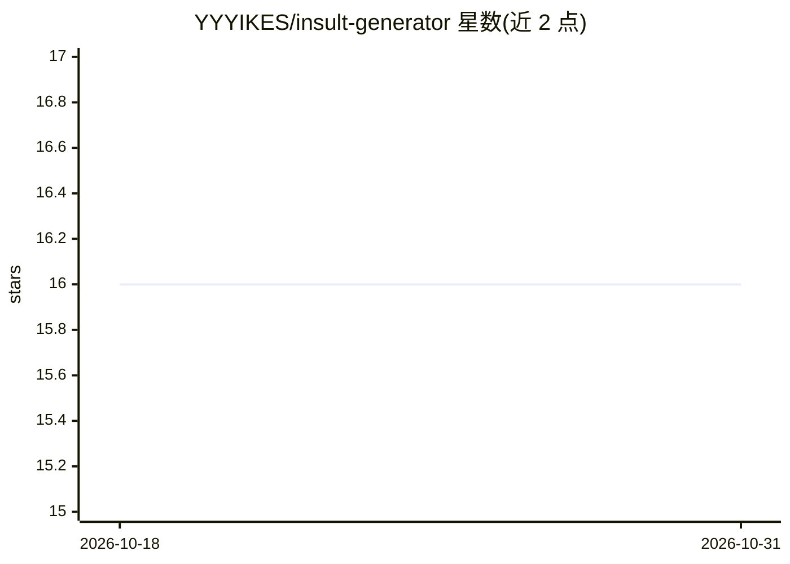

# YYYIKES/insult-generator

⭐ 16 · Python · GPL-3.0 · 推送 2026-02-20 · [GitHub](https://github.com/YYYIKES/insult-generator) · 个人维护

**Markov 链辱骂语生成器：Flask 网页应用+Python 脚本**

基于 Markovify 包的辱骂文本生成器，从网上抓取并整理的辱骂数据集训练 Markov 链，生成随机辱骂句子。提供 Python3 脚本形式，并附带 Flask 构建的 Web 应用；README 提供在线演示链接（Heroku 域名）与多条生成示例。面向娱乐用途，供用户生成调侃朋友的辱骂语句。README 未给出安装或运行命令。

## 筛选速览

| 维度 | 判定 | 备注 |
|---|---|---|
| AI 角色 | `ai-native` | 本体是模型或模型工具 |
| 许可风险 | `viral` | GPL-3.0 |
| 部署形态 | `None` |  |
| 模型依赖 | — | README 未给出锁定关系 |
| 硬件要求 | — | 无带数字的原话,不猜 |
| 安装摩擦 | `low` | 无编译、无系统依赖或容器化 |
| 成熟度 | — | 结构信号不足 |

## 能力要点

- 基于 Markovify 的 Markov 链文本生成
- 附带 Flask Web 应用
- 训练数据来自网上抓取并编辑的辱骂数据集
- 提供在线演示链接

## 适用场景

- 生成随机辱骂语句调侃朋友
- 学习 Markov 链文本生成与 Flask 应用的示例

## 场景标签

`AI 写作` · 领域:内容生成

## 证据(README 行号)

> L3: #### Offend your friends and family! Generate scathing insults based on an edited dataset of insults scraped from va
> L5: *Script written in Python3 using the Markovify package.*

## 星数曲线

2026-10-18 16 → 2026-10-31 16（+0）

---
*卡片 v1 · prompt 1.4 · 生成 2026-10-30 · 置信度 mid · 依据 README sha `1aeaed3a0939` · [字段定义](../../DATASET.md)*
