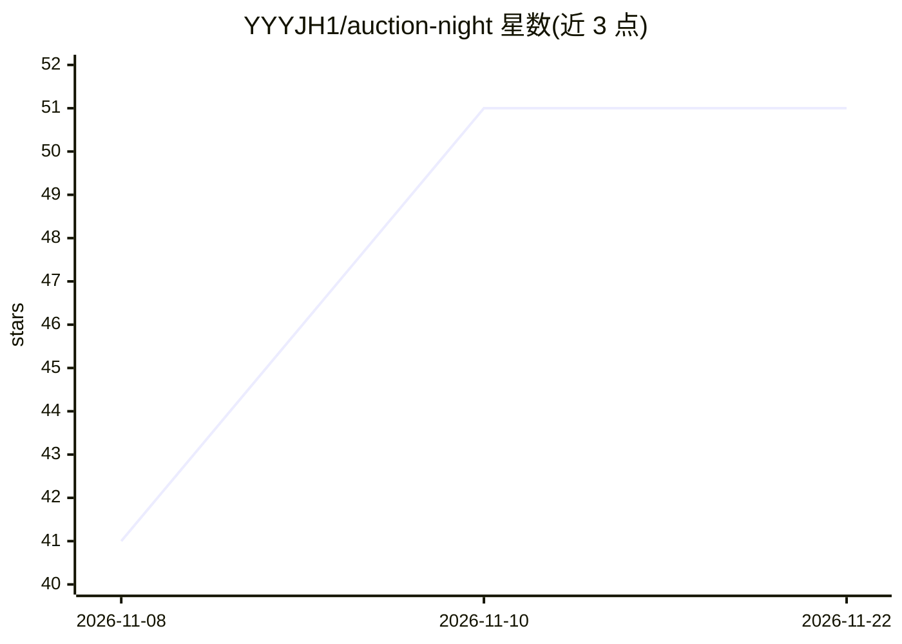

# YYYJH1/auction-night

⭐ 51 · Python · MIT · 推送 2026-11-03 · [GitHub](https://github.com/YYYJH1/auction-night) · [官网](https://yyyjh1.github.io/auction-night/) · 个人维护 · 中文 README

**六个 LLM 与两个规则机器人在六种拍卖规则下竞价的实验框架**

让六个语言模型和两个规则机器人在一晚内以六种教科书拍卖机制（英式、荷式、一价密封、二价密封、全员支付、盲盒）竞拍十二件拍品，晚间含桌上谈判、公开承诺、秘密任务，赛后由主持与两位评审复盘。每晚保存为逐字节可复现的录像，导出为静态回放页面；提供 mock 模式（无需网络与密钥），真实模型经阿里云百炼 API 或本机 vLLM/Ollama 接入，附赛季排行榜与透明度文档。

## 筛选速览

| 维度 | 判定 | 备注 |
|---|---|---|
| AI 角色 | `ai-native` | 本体是模型或模型工具 |
| 许可风险 | `permissive` | MIT |
| 部署形态 | `None` |  |
| 模型依赖 | local-ok | 支持本地模型 |
| 硬件要求 | — | 无带数字的原话,不猜 |
| 安装摩擦 | `low` | 无编译、无系统依赖或容器化 |
| 成熟度 | — | 结构信号不足 |

## 能力要点

- 六种教科书拍卖机制与理论结果对照
- 每晚录像逐字节复现并发布为静态回放页
- mock 模式无需网络与 API key 即可运行
- 真实模型走阿里云百炼 API，或本机 vLLM/Ollama 零成本

## 适用场景

- 观察 LLM 在不同拍卖机制下的竞价与共谋行为
- 复现实验结果并发布静态回放页
- 举办多模型赛季并生成排行榜

## 场景标签

`多智能体` `模型评测` · 领域:Agent 开发

## 证据(README 行号)

> L5:  Six language models and two rule-based bots bid for twelve lots under six textbook auction rules. Afterwards a host
> L18: - Six language models and two rule-based bots bid for twelve lots in one night.
> L19: - Each lot is sold under one of six textbook auctions.

## 星数曲线

2026-11-08 41 → 2026-11-22 51（+10）

---
*卡片 v1 · prompt 1.4 · 生成 2026-11-18 · 置信度 high · 依据 README sha `49fad67b58c5` · [字段定义](../../DATASET.md)*
