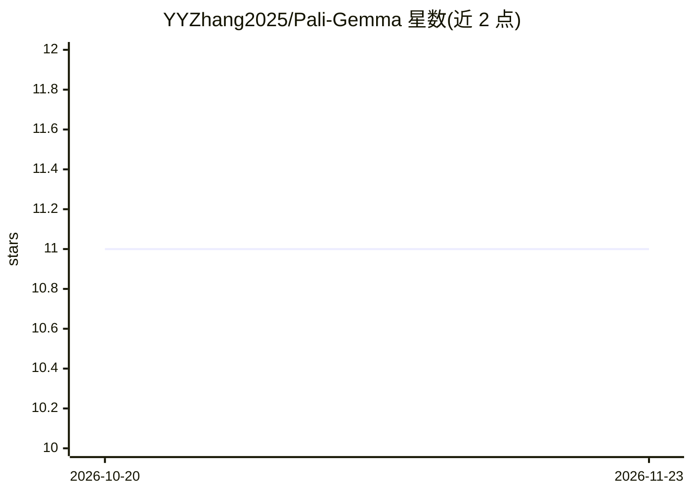

# YYZhang2025/Pali-Gemma

⭐ 11 · Jupyter Notebook · 推送 2026-02-12 · [GitHub](https://github.com/YYZhang2025/Pali-Gemma) · 个人维护

**多模态 LLM 的实现与 LoRA 微调代码库**

实现 Pali-Gemma 多模态模型的完整流程与推理管线，并使用 LoRA 对模型进行微调。代码仅依赖 PyTorch，不依赖其他额外库。README 内容简短，说明模型实现过程、推理管线，并提及提供 Gradio 演示。适合希望了解或复现该模型实现与微调流程的开发者与研究者使用。

## 筛选速览

| 维度 | 判定 | 备注 |
|---|---|---|
| AI 角色 | `ai-native` | 本体是模型或模型工具 |
| 许可风险 | `none` | — |
| 部署形态 | `None` |  |
| 模型依赖 | — | README 未给出锁定关系 |
| 硬件要求 | — | 无带数字的原话,不猜 |
| 安装摩擦 | `low` | 无编译、无系统依赖或容器化 |
| 成熟度 | — | 结构信号不足 |

## 能力要点

- 实现多模态 LLM 及推理管线
- 支持使用 LoRA 进行模型微调
- 仅依赖 PyTorch，不依赖其他库
- 提供 Gradio Demo

## 适用场景

- 复现 Pali-Gemma 模型的实现流程
- 用 LoRA 对多模态模型做微调实验
- 在本地运行 Gradio 演示查看推理效果

## 场景标签

`微调` `多模态` · 领域:感知与多模态

## 证据(README 行号)

> L4: Below are the full process of the Pali-Gemma Model and the inference pipeline.
> L6: ## Gradio Demo

## 星数曲线

2026-10-20 11 → 2026-11-23 11（+0）

---
*卡片 v1 · prompt 1.4 · 生成 2026-11-18 · 置信度 low · 依据 README sha `92e4baee6206` · [字段定义](../../DATASET.md)*
