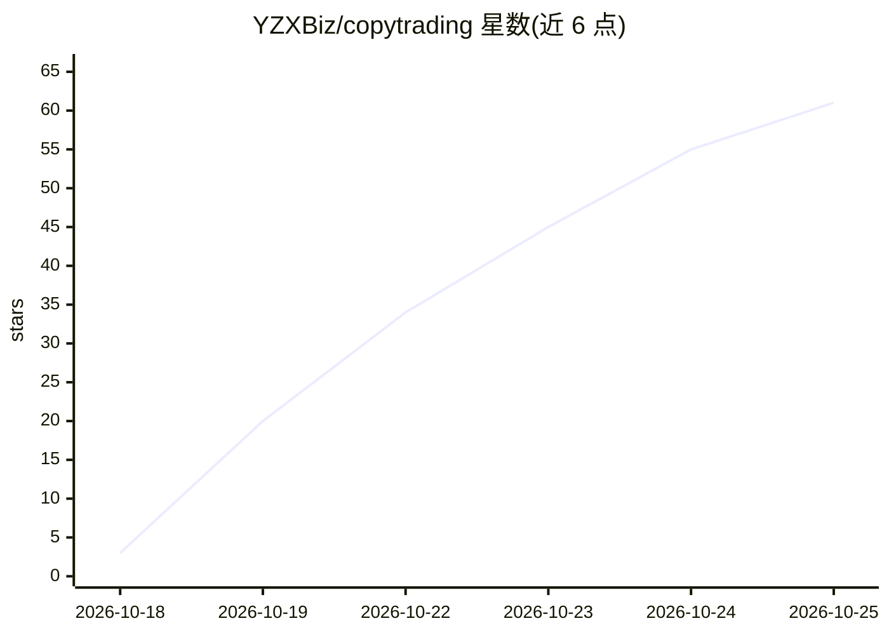

# YZXBiz/copytrading

⭐ 69 · Python · MIT · 推送 2026-10-25 · [GitHub](https://github.com/YZXBiz/copytrading) · [官网](https://github.com/YZXBiz/copytrading/releases) · 个人维护 · 中文 README

**macOS 跟单应用：读取 Discord 交易信号并限风下单到 Alpaca**

原生 macOS 应用（SwiftUI 界面 + 本地 Python 引擎，SQLite 持久化）：读取指定 Discord 频道的交易帖，由用户选择的模型解读为订单，经日损、单笔、单标的与总敞口限额校验后提交至 Alpaca 账户，全部本地运行。每笔持仓可溯源到原帖，密钥存 macOS 钥匙串，任何下单操作需 Touch ID 确认。支持十余家托管模型服务、Ollama 本地模型及任意 OpenAI 兼容地址，界面支持英文/简体中文。自称 Developer preview，未通过实盘验证，建议先用 Alpaca paper 账户。

## 筛选速览

| 维度 | 判定 | 备注 |
|---|---|---|
| AI 角色 | `ai-enhanced` | 去掉 AI 部分产品仍成立 |
| 许可风险 | `permissive` | MIT |
| 部署形态 | `None` |  |
| 模型依赖 | local-ok | 支持本地模型 |
| 硬件要求 | — | 无带数字的原话,不猜 |
| 安装摩擦 | `low` | 无编译、无系统依赖或容器化 |
| 成熟度 | `idea` | |

## 能力要点

- 模型解读帖子时要求每个 ticker/价格/比例必须出现在原帖，不得生成数字
- 按账户的日损、单笔、单标的与总敞口限额在每笔买入前校验
- 每笔持仓记录来源帖子，可按 lot 单独卖出
- 提供 CLI 与 MCP server，引擎可脱离应用在 Linux 服务器运行并附 Docker 镜像

## 适用场景

- 把我关注的 Discord 交易员的喊单自动转成限额内的 Alpaca 订单
- 用 paper 账户先验证跟单策略再考虑实盘
- 多个交易员分别对应多个账户并行跟单

## 场景标签

`金融量化` · 领域:学习与行业

## 证据(README 行号)

> L17: CopyTrading is a native macOS app that reads the stock calls traders post on Discord, turns each one into an exact 
> L45: - **An assistant that cannot trade on its own.** ⌘J answers from your real posts and accounts. Anything that could 
> L48: Works with a dozen hosted model services, local models through Ollama, or any OpenAI-compatible address, in English

## 星数曲线

2026-10-18 3 → 2026-10-25 61（+58）

---
*卡片 v1 · prompt 1.4 · 生成 2026-10-24 · 置信度 high · 依据 README sha `af3431c609c7` · [字段定义](../../DATASET.md)*
