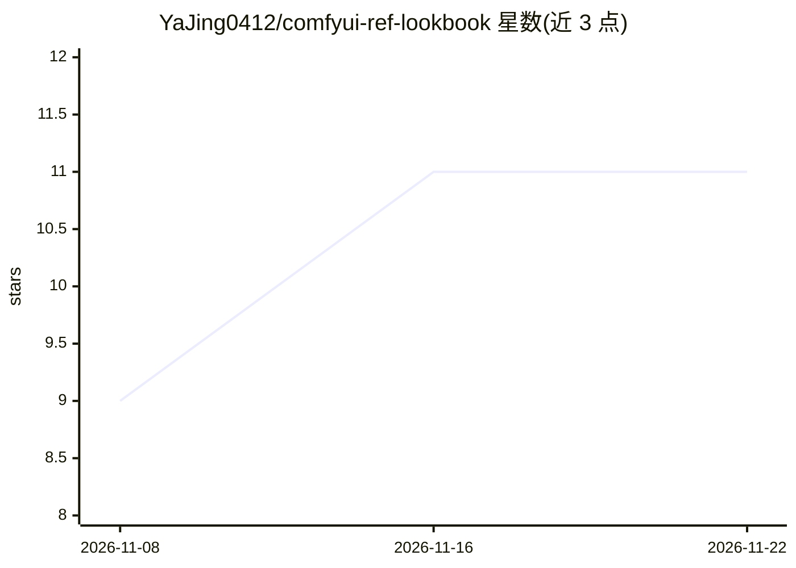

# YaJing0412/comfyui-ref-lookbook

⭐ 11 · Python · MIT · 推送 2026-11-16 · [GitHub](https://github.com/YaJing0412/comfyui-ref-lookbook) · 个人维护 · 中文 README

**给 ComfyUI 用户提供参考图册节点库与组合出图工作流**

ComfyUI 节点包：把六套公开 AI 参考素材（服装/姿势/脸部/深度姿势等）收进图库节点，合计 5,828 条记录、8,411 张内置缩略图，支持中英日关键词与编号搜索，可固定脸换装等组合方式出图。原图因上游禁止再分发，运行时按单张获取并缓存，支持离线模式。附 Qwen Image 2.1 示例工作流，需自行准备四个模型文件；仓库代码 MIT，图片与索引不在 MIT 范围内。

## 筛选速览

| 维度 | 判定 | 备注 |
|---|---|---|
| AI 角色 | `ai-native` | 本体是模型或模型工具 |
| 许可风险 | `permissive` | MIT |
| 部署形态 | `None` |  |
| 模型依赖 | — | README 未给出锁定关系 |
| 硬件要求 | — | 无带数字的原话,不猜 |
| 安装摩擦 | `low` | 无编译、无系统依赖或容器化 |
| 成熟度 | — | 结构信号不足 |

## 能力要点

- 六库合一的图库节点：5,828 条记录、8,411 张内置缩略图可离线浏览
- 四合一角色配方节点一次取发型/脸/服装/姿势四张图并拼好提示词
- 深度库与姿势库同编号一一对应，可直接接 ControlNet depth
- 附零依赖独立 HTTP 服务，不开 ComfyUI 也能浏览图库

## 适用场景

- 在 ComfyUI 里组合姿势/脸/服装参考图生成人物
- 固定一张脸或服装批量对比不同搭配效果
- 无网络环境下浏览和检索参考素材

## 场景标签

`图像生成` · 领域:内容生成

## 证据(README 行号)

> L3: ComfyUI 节点包：把六套公开的 AI 参考素材（服装 / 服装动画 / 姿势 / 脸 / 深度姿势 / 二次元）收进图库节点，任选组合出图；另附一个独立的澪设计档案库（作者原版提示词）。**仓库只发代码、索引与内置缩略图，原图
> L96: 只用 ComfyUI 内置节点。四个模型自行准备，放好后重启 ComfyUI：

## 星数曲线

2026-11-08 9 → 2026-11-22 11（+2）

---
*卡片 v1 · prompt 1.4 · 生成 2026-11-19 · 置信度 high · 依据 README sha `62479897f192` · [字段定义](../../DATASET.md)*
