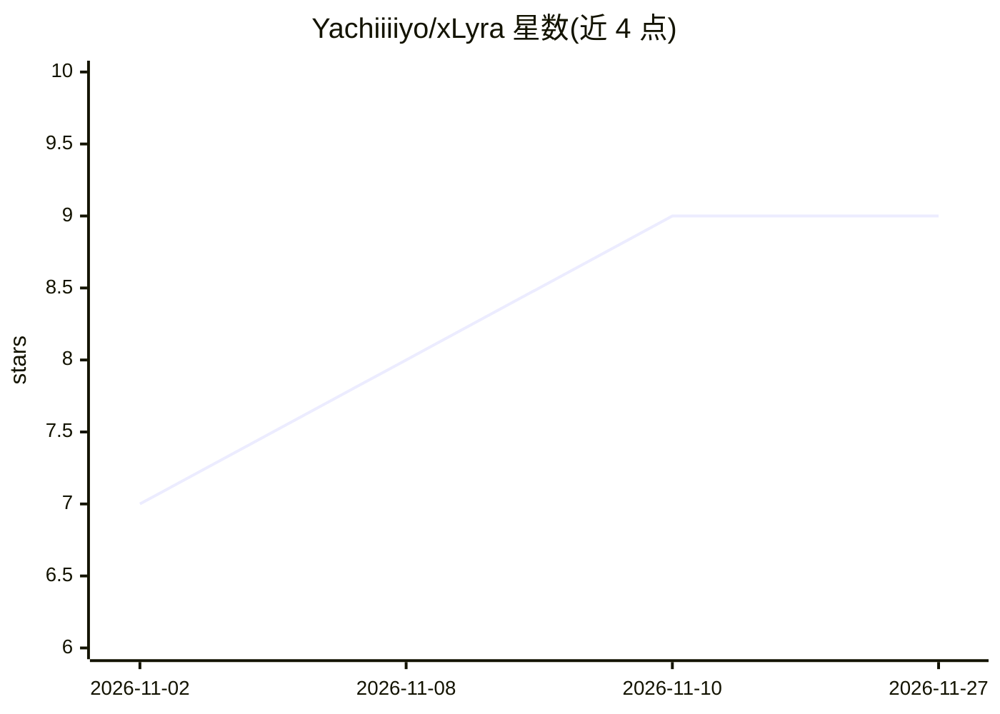

# Yachiiiiyo/xLyra

⭐ 9 · Go · AGPL-3.0 · 推送 2026-11-26 · [GitHub](https://github.com/Yachiiiiyo/xLyra) · [官网](https://xlyra.yachiyo.im) · 个人维护 · 中文 README

**自托管多站点 AI 网关与控制台：统一接入与路由多上游**

自托管的 AI 网关、LLM 代理与控制平面，聚合多个 AI 提供商、中转站、OAuth 账户与 OpenAI 兼容端点，对外提供单一 API。支持 Chat Completions、Responses、Messages 与 Gemini 协议互转、OAuth 账户编排与令牌刷新、基于健康/延迟/价格/冷却的路由与故障转移、API key 配额与模型权限、用量成本追踪与实时流量观测。以 Go 后端加 React 控制台的单镜像通过 Docker Compose 部署，依赖 PostgreSQL。插件与 Agent 文档为中文。

## 筛选速览

| 维度 | 判定 | 备注 |
|---|---|---|
| AI 角色 | `ai-ecosystem` | LLM/agent 周边工具 |
| 许可风险 | `viral` | AGPL-3.0 |
| 部署形态 | `self-host` | docker 或自建部署 |
| 模型依赖 | locked-api |  |
| 硬件要求 | — | 无带数字的原话,不猜 |
| 安装摩擦 | `low` | 无编译、无系统依赖或容器化 |
| 成熟度 | — | 结构信号不足 |

## 能力要点

- Chat/Responses/Messages/Gemini 协议双向转换
- 基于健康、延迟、价格、冷却与优先级的路由与故障转移
- OAuth 账户编排与令牌刷新（Codex/Claude Code/Grok/Antigravity）
- JS 插件扩展与内置对话式 Agent 工作区

## 适用场景

- 集中管理多个中转站与官方账户的密钥、模型与价格
- 为下游应用提供统一 API 端点并做协议转换
- 对多上游流量做成本核算与实时观测

## 场景标签

`模型网关` `LLM 可观测性` · 领域:Agent 开发

## 证据(README 行号)

> L15: xLyra is a self-hosted AI gateway, LLM proxy, and control plane for aggregating multiple AI providers, relay statio
> L17: It provides one API endpoint for OpenAI, Anthropic, Claude Code, Codex, Gemini, Grok, Antigravity, DeepSeek, NewAPI

## 星数曲线

2026-11-02 7 → 2026-11-27 9（+2）

---
*卡片 v1 · prompt 1.4 · 生成 2026-11-20 · 置信度 high · 依据 README sha `b089ef948054` · [字段定义](../../DATASET.md)*
