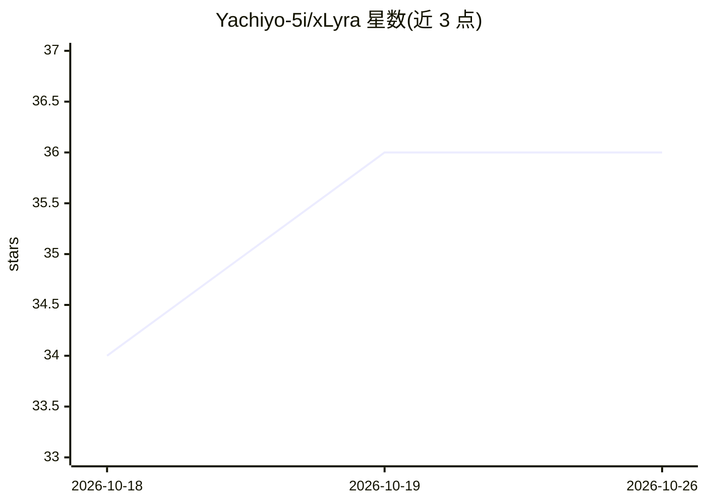

# Yachiyo-5i/xLyra

⭐ — · [GitHub]() · 组织维护 · 中文 README

**自托管多站点 AI 网关与控制平面：统一路由多家上游**

面向需要聚合多个 AI 提供商、中转站与 OAuth 账号的开发者和团队：以单一 OpenAI 兼容端点代理 OpenAI、Anthropic、Gemini、Grok、Codex、DeepSeek 等上游，支持 Chat/Responses/Messages/Gemini 协议互转、OAuth 令牌编排与刷新、基于健康/延迟/价格的路由评分与故障转移冷却、API key 配额与模型权限、用量成本统计与实时流量图。附带 Web 控制台、JS 插件扩展与对话式 Agent 工作区。Docker Compose 部署两个服务（xlyra 单镜像 + PostgreSQL）。插件与 Agent 文档为中文。

## 筛选速览

| 维度 | 判定 | 备注 |
|---|---|---|
| AI 角色 | `ai-ecosystem` | LLM/agent 周边工具 |
| 许可风险 | `viral` | — |
| 部署形态 | `self-host` | docker 或自建部署 |
| 模型依赖 | locked-api |  |
| 硬件要求 | — | 无带数字的原话,不猜 |
| 安装摩擦 | `low` | 无编译、无系统依赖或容器化 |
| 成熟度 | — | 结构信号不足 |

## 能力要点

- Chat/Responses/Messages/Gemini 多协议透明转换
- 按健康、延迟、价格、冷却状态评分的多站点路由与故障转移
- Codex/Antigravity/Claude Code/Grok OAuth 账号编排与令牌刷新
- 下游 API key 配额、模型/站点权限与用量成本可观测
- JS 插件扩展（配额探测、自定义协议、自动化等）

## 适用场景

- 把多个中转站与官方账号聚合成一个统一 API 端点给下游应用
- 按下游 key 控制可访问的模型和站点并统计成本
- 上游故障时自动冷却与故障转移保障生产流量
- 在自托管控制台里管理上游凭据、价格与流量观测

## 场景标签

`模型网关` · 领域:Agent 开发

## 证据(README 行号)

> L15: xLyra is a self-hosted AI gateway, LLM proxy, and control plane for aggregating multiple AI providers, relay statio
> L17: It provides one API endpoint for OpenAI, Anthropic, Claude Code, Codex, Gemini, Grok, Antigravity, DeepSeek, NewAPI
> L31: - Self-hosted deployment with Docker Compose

## 星数曲线

2026-10-18 34 → 2026-10-26 36（+2）

---
*卡片 v1 · prompt 1.4 · 生成 2026-10-25 · 置信度 high · 依据 README sha `338c7aace047` · [字段定义](../../DATASET.md)*
