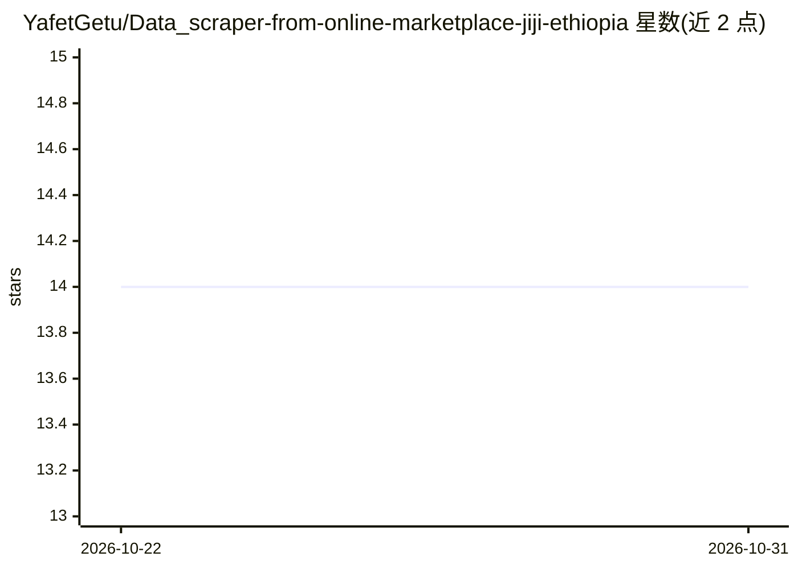

# YafetGetu/Data_scraper-from-online-marketplace-jiji-ethiopia

⭐ 14 · Python · 推送 2026-08-28 · [GitHub](https://github.com/YafetGetu/Data_scraper-from-online-marketplace-jiji-ethiopia) · 个人维护

**从 Jiji 埃塞俄比亚集市抓取商品列表的爬虫工具**

基于 Python、BeautifulSoup 和 Requests 的网页抓取工具，从 Jiji Ethiopia 在线集市提取商品标题、价格与分类，并导出为 JSON 和 CSV 格式。提供重试机制、可配置的请求延迟与超时、日志系统，要求 Python 3.8+、Git 与 pip，通过 git clone 源码安装。作者声明该项目为作品集维护与持续开发项目。README 标题提及价格估算与预测，但可见行文中未展示相应实现细节。

## 筛选速览

| 维度 | 判定 | 备注 |
|---|---|---|
| AI 角色 | `ai-ecosystem` | LLM/agent 周边工具 |
| 许可风险 | `none` | — |
| 部署形态 | `None` |  |
| 模型依赖 | — | README 未给出锁定关系 |
| 硬件要求 | — | 无带数字的原话,不猜 |
| 安装摩擦 | `low` | 无编译、无系统依赖或容器化 |
| 成熟度 | — | 结构信号不足 |

## 能力要点

- 抓取商品标题、价格、分类并导出 JSON/CSV
- 重试机制与可配置请求延迟/超时
- 日志系统用于调试与监控

## 适用场景

- 收集埃塞俄比亚二手市场的商品价格数据
- 导出结构化数据用于后续分析
- 监控在线集市商品列表变化

## 场景标签

`网页抓取` · 领域:效率与自动化

## 证据(README 行号)

> L9: A professional web scraping tool for extracting product listings from the Jiji Ethiopia online marketplace.
> L14: - Product listing scraping (titles, prices, categories)

## 星数曲线

2026-10-22 14 → 2026-10-31 14（+0）

---
*卡片 v1 · prompt 1.4 · 生成 2026-10-31 · 置信度 mid · 依据 README sha `80b18abe5106` · [字段定义](../../DATASET.md)*
