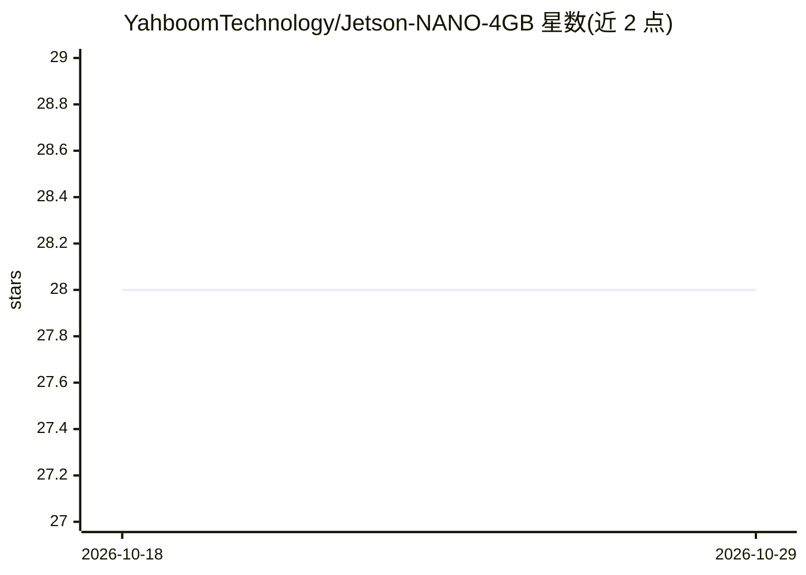

# YahboomTechnology/Jetson-NANO-4GB

⭐ 28 · 推送 2026-08-14 · [GitHub](https://github.com/YahboomTechnology/Jetson-NANO-4GB) · [官网](https://category.yahboom.net/products/jetson-nano-sub) · 组织维护 · 中文 README

**Jetson Nano 4GB 开发套件的硬件介绍与支持文档**

这是 Yahboom 发布的 Jetson Nano B01 4GB 开发者套件的产品说明：搭载四核 Cortex-A57 处理器、128 核 Maxwell GPU 与 4GB LPDDR 内存，算力 472 GFLOPS，功耗可低至 5 瓦；提供显示、USB、千兆网口、micro USB、DC 供电、PoE 与摄像头接口，可加装带天线的无线网卡。README 说明该板可并行运行多个神经网络，支持 TensorFlow、PyTorch、Caffe/Caffe2、Keras、MXNet 等框架，主要用于图像分类、目标检测、分割与语音处理。仅含产品介绍与联系方式，不含安装运行说明。

## 筛选速览

| 维度 | 判定 | 备注 |
|---|---|---|
| AI 角色 | `ai-ecosystem` | LLM/agent 周边工具 |
| 许可风险 | `none` | — |
| 部署形态 | `None` |  |
| 模型依赖 | — | README 未给出锁定关系 |
| 硬件要求 | — | 无带数字的原话,不猜 |
| 安装摩擦 | `low` | 无编译、无系统依赖或容器化 |
| 成熟度 | — | 结构信号不足 |

## 能力要点

- 四核 Cortex-A57 + 128 核 Maxwell GPU + 4GB LPDDR，472 GFLOPS
- 可并行运行多个神经网络，功耗低至 5 瓦
- 支持 TensorFlow/PyTorch/Caffe/Keras/MXNet 等 AI 框架
- 板载显示、USB、千兆网、PoE、摄像头接口，可加无线网卡

## 适用场景

- 在低功耗边缘设备上运行图像分类、目标检测、分割与语音处理
- 作为部署多个并行神经网络的嵌入式 AI 硬件平台

## 场景标签

 · 领域:嵌入式 AI 硬件

## 证据(README 行号)

> L4: Jetson Nano B01 Developer Kit is a small, powerful computer that lets you run multiple neural networks in parallel f
> L6: The JETSON NANO with a quad-core CORTEX-A57 processor, a 128-core MAXWELL GPU and 4GB of LPDDR memory with power Al 

## 星数曲线

2026-10-18 28 → 2026-10-29 28（+0）

---
*卡片 v1 · prompt 1.4 · 生成 2026-10-26 · 置信度 mid · 依据 README sha `57aa66490755` · [字段定义](../../DATASET.md)*
