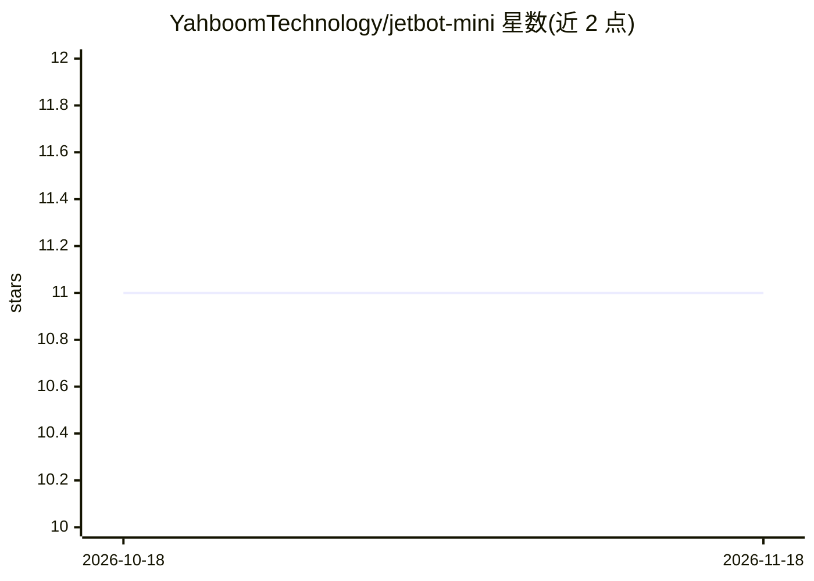

# YahboomTechnology/jetbot-mini

⭐ 11 · 推送 2025-11-26 · [GitHub](https://github.com/YahboomTechnology/jetbot-mini) · [官网](https://category.yahboom.net/products/jetbot-mini) · 组织维护

**基于 Jetson Nano 2GB 的 ROS AI 视觉机器人套件**

Yahboom 推出的基于 NVIDIA Jetson Nano 2GB 开发板的 ROS 人工智能机器人小车，内置 ROS 操作系统，以 OpenCV 作为图像处理库，主编程语言为 Python3，可通过 JupyterLab 在线编程开发。支持自动巡航、颜色识别、人脸检测、AR 标签识别等 AI 功能，支持手机 APP/手柄/PC 跨平台互联控制，并附开源课程与对应源码。摄像头俯仰角可手动调节；手柄为可选配件。

## 筛选速览

| 维度 | 判定 | 备注 |
|---|---|---|
| AI 角色 | `ai-native` | 本体是模型或模型工具 |
| 许可风险 | `none` | — |
| 部署形态 | `None` |  |
| 模型依赖 | — | README 未给出锁定关系 |
| 硬件要求 | — | 无带数字的原话,不猜 |
| 安装摩擦 | `low` | 无编译、无系统依赖或容器化 |
| 成熟度 | — | 结构信号不足 |

## 能力要点

- 基于 NVIDIA Jetson Nano 2GB 的 ROS 机器人套件
- 提供自动巡航、颜色识别、人脸检测、AR 标签识别等 AI 功能
- 支持手机 APP、手柄、PC 跨平台互联控制
- 附赠开源课程与源码、免费技术支持

## 适用场景

- 学习 ROS 机器人编程入门
- 练习 Jetson Nano 上的 AI 视觉项目
- 通过手机 APP 或手柄遥控小车

## 场景标签

`教程课程` `人脸识别` `图像视频处理` · 领域:学习与行业

## 证据(README 行号)

> L4: JETBOT MINI is a ROS artificial intelligence robot based on the NVIDIA JETSON NANO 2GB board. Built-in ROS(robot ope
> L12: * Multi interesting AI functions: Autopilot, color recognition, face detection, AR tag recognition, visual image be

## 星数曲线

2026-10-18 11 → 2026-11-18 11（+0）

---
*卡片 v1 · prompt 1.4 · 生成 2026-11-18 · 置信度 high · 依据 README sha `172f674d4b15` · [字段定义](../../DATASET.md)*
