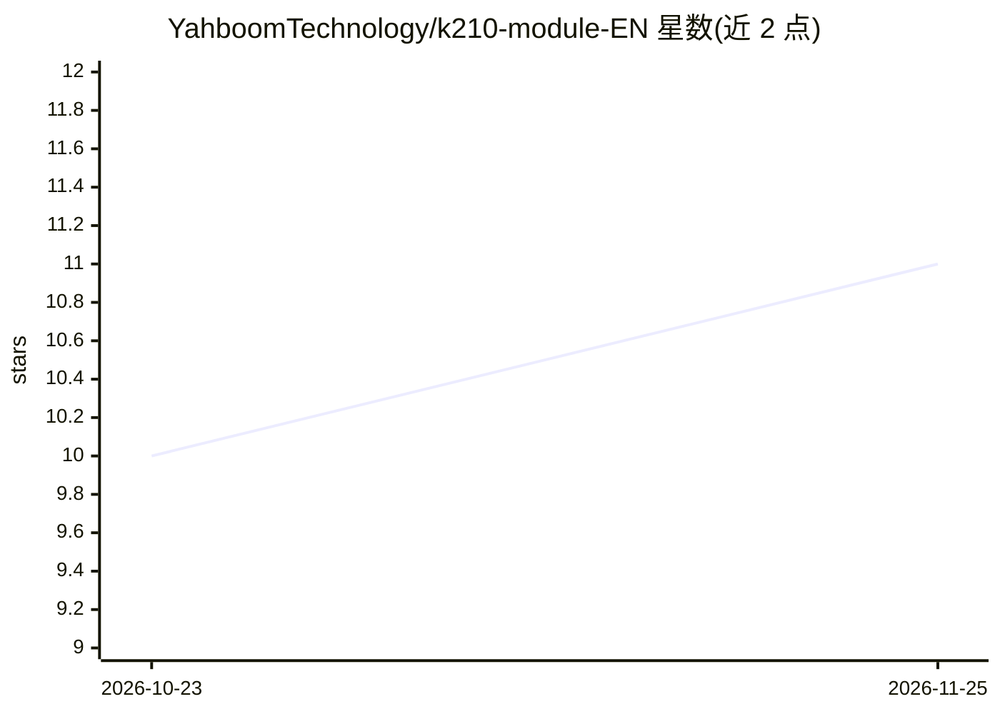

# YahboomTechnology/k210-module-EN

⭐ 11 · 推送 2026-09-14 · [GitHub](https://github.com/YahboomTechnology/k210-module-EN) · [官网](https://category.yahboom.net/products/k210-module) · 组织维护 · 中文 README

**面向嵌入式开发者的 K210 视觉识别模块（AI 硬件）**

基于 Kendryte K210 芯片的图像处理模块，双核 64 位处理器，算力 1TOPS，采用深度学习算法识别图像中的物体与特征。板载 OV2640 摄像头、2.0 英寸 LCD 触摸屏、可编程 RGB 灯，支持 TF 卡；通过串口可与 STM32、Raspberry Pico、Arduino、Micro:bit 等控制器交互。MicroPython 代码全部开源，随附 40+ 篇教程；提供三种高度支架，可固定于机器人或智能小车。购买链接与技术支持联系方式在 README 中给出。

## 筛选速览

| 维度 | 判定 | 备注 |
|---|---|---|
| AI 角色 | `ai-native` | 本体是模型或模型工具 |
| 许可风险 | `none` | — |
| 部署形态 | `None` |  |
| 模型依赖 | — | README 未给出锁定关系 |
| 硬件要求 | — | 无带数字的原话,不猜 |
| 安装摩擦 | `low` | 无编译、无系统依赖或容器化 |
| 成熟度 | — | 结构信号不足 |

## 能力要点

- K210 双核 64 位处理器，算力 1TOPS
- 支持人脸/口罩/二维码/数字/颜色识别与巡线等识别功能
- 板载 OV2640 摄像头、2.0 英寸触摸屏、RGB 灯，支持 TF 卡
- MicroPython 代码开源，提供 40+ 教程

## 适用场景

- 给机器人或智能小车加装视觉识别能力
- 教学场景中学习嵌入式 AI 与 MicroPython
- 搭建人脸识别、口罩识别、巡线检测等演示项目

## 场景标签

`教程课程` `人脸识别` `目标检测` · 领域:学习与行业

## 证据(README 行号)

> L4: Yahboom K210 visual recognition module is an image processing module based on artificial intelligence technology. It
> L10: 3) Support face recognition, mask recognition, QR code recognition, feature detection, number recognition, color re

## 星数曲线

2026-10-23 10 → 2026-11-25 11（+1）

---
*卡片 v1 · prompt 1.4 · 生成 2026-11-20 · 置信度 high · 依据 README sha `447f4b4c1c79` · [字段定义](../../DATASET.md)*
