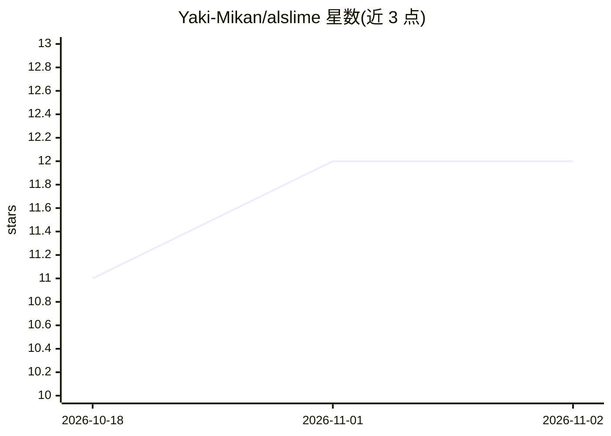

# Yaki-Mikan/alslime

⭐ 12 · TypeScript · NOASSERTION · 推送 2026-11-01 · [GitHub](https://github.com/Yaki-Mikan/alslime) · [官网](https://github.com/Yaki-Mikan/alslime/blob/main/docs/manual/index.md) · 个人维护

**本地运行的 AI 角色扮演前端：接入 Gemini CLI / Claude Code / Antigravity 与自设角色对话**

在用户 PC 上运行本地服务器的角色扮演会话前端：设定角色性格、外見、世界观、文体与会话内时间，最多 5 名角色同场对话，会话作为会话保存并支持设定包导出。AI 能力通过用户自行安装认证的 Gemini CLI、Claude Code、Antigravity 提供，浏览器界面选择 AI 与模型。数据（历史、设定）保存在本地 Markdown 文件，不向开发者发送。图像生成（ComfyUI）与语音朗读（Irodori-TTS）为 GitHub Sponsors 支持者功能且需自建 GPU 环境。采用 PolyForm Noncommercial 许可，source-available，18 岁以上可用，不接收 PR。

## 筛选速览

| 维度 | 判定 | 备注 |
|---|---|---|
| AI 角色 | `ai-native` | 本体是模型或模型工具 |
| 许可风险 | `none` | NOASSERTION |
| 部署形态 | `None` |  |
| 模型依赖 | locked-api |  |
| 硬件要求 | — | 无带数字的原话,不猜 |
| 安装摩擦 | `low` | 无编译、无系统依赖或容器化 |
| 成熟度 | — | 结构信号不足 |

## 能力要点

- 接入 Gemini CLI / Claude Code / Antigravity 三种 AI CLI，浏览器界面选择模型
- 角色、世界观、文体、会话内日期时间的组合设定，最多 5 角色同场
- 会话历史与设定以 Markdown 保存在本地，支持设定包备份与迁移
- 支持者功能的 ComfyUI 场景图像生成与 Irodori-TTS 日语朗读

## 适用场景

- 与自定义角色和世界观进行持续的角色扮演对话
- 在同一本地环境切换不同 AI CLI 和模型进行对话
- 把角色和世界设定打包，搬到另一台 PC 继续

## 场景标签

`聊天机器人` · 领域:对话与助手

## 证据(README 行号)

> L7: AlSlimeは、自作したキャラクターとの会話を楽しむためのAI CLIフロントエンドです。キャラクターだけでなく、世界観、舞台、シチュエーション、文体、会話内の時間まで組み合わせ、ひとつの世界として会話を続けられます。
> L9: 利用者が導入・認証したGemini CLI、Claude Code、Antigravityを、ブラウザの会話画面から利用します。会話履歴と設定は手元のPCへ保存されます。
> L27: Gemini CLI、Claude Code、Antigravityに対応しています。各CLIで済ませた認証を利用し、会話するキャラクターや用途に合わせてAIとモデルを選べます。

## 星数曲线

2026-10-18 11 → 2026-11-02 12（+1）

---
*卡片 v1 · prompt 1.4 · 生成 2026-11-01 · 置信度 high · 依据 README sha `05f37c1d5ac4` · [字段定义](../../DATASET.md)*
