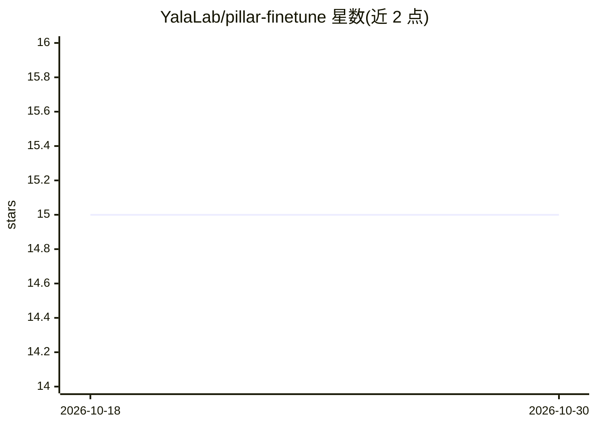

# YalaLab/pillar-finetune

⭐ 15 · Python · NOASSERTION · 推送 2026-10-12 · [GitHub](https://github.com/YalaLab/pillar-finetune) · 组织维护

**Pillar 放射学基础模型的微调框架，供科研使用**

面向 Pillar 系列医学影像基础模型（Pillar0）的微调与评估代码库：提供 NLST 数据集微调脚本、基于 CSV 的数据集接入（DICOM 序列/NIfTI 路径）、生存评估指标输出，以及多 GPU 推理验证脚本。数据预处理依赖配套仓库 rad-vision-engine 处理胸部 CT；受门控模型（MedGemma、MedImageInsight）需 HuggingFace 登录。安装采用 uv 环境管理并单独安装 flash-attn，引用 Pillar-0 论文。

## 筛选速览

| 维度 | 判定 | 备注 |
|---|---|---|
| AI 角色 | `ai-ecosystem` | LLM/agent 周边工具 |
| 许可风险 | `none` | NOASSERTION |
| 部署形态 | `library` | 以包/库形式分发 |
| 模型依赖 | — | README 未给出锁定关系 |
| 硬件要求 | — | 无带数字的原话,不猜 |
| 安装摩擦 | `low` | 无编译、无系统依赖或容器化 |
| 成熟度 | — | 结构信号不足 |

## 能力要点

- 提供 NLST 数据集上微调 Pillar0 的脚本
- CSV 数据集接入 DICOM 序列与 NIfTI，支持生存评估
- 含安装自检脚本与多 GPU 验证脚本

## 适用场景

- 在我的胸部 CT 数据上微调 Pillar0 模型
- 复现 NLST 数据集上的微调与评估流程
- 将自有 DICOM/NIfTI 数据组织为微调数据集

## 场景标签

`微调` `科研工具` · 领域:学习与行业

## 证据(README 行号)

> L3: Finetuning framework for Pillar medical imaging models.
> L19: ## Fine-tuning Pillar0 on NLST Dataset

## 星数曲线

2026-10-18 15 → 2026-10-30 15（+0）

---
*卡片 v1 · prompt 1.4 · 生成 2026-10-30 · 置信度 mid · 依据 README sha `77c0a2727bce` · [字段定义](../../DATASET.md)*
