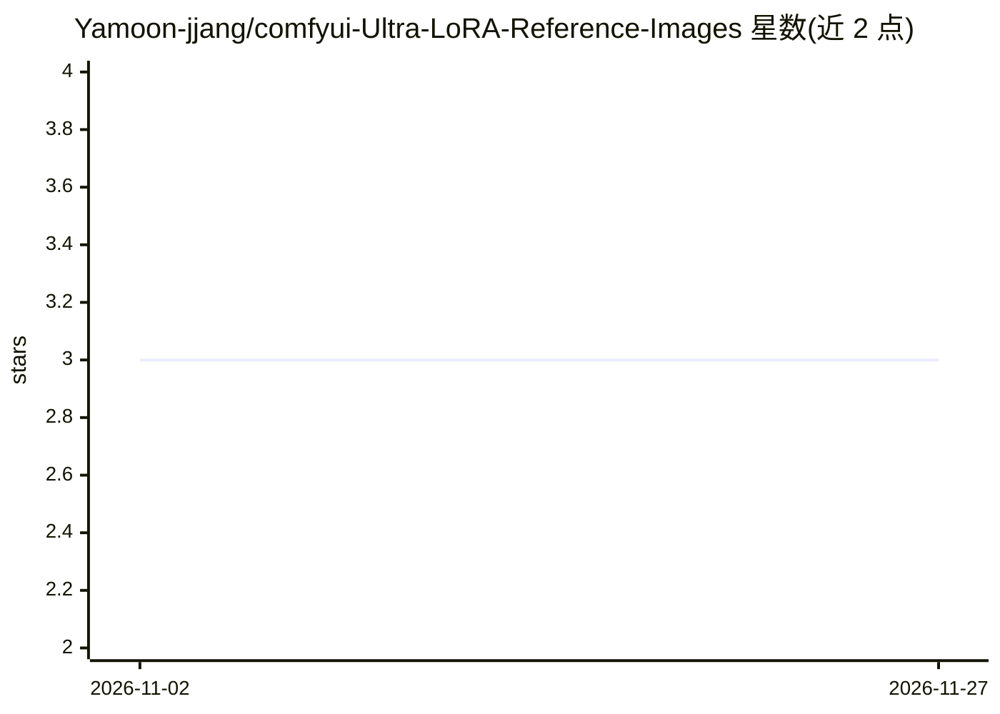

# Yamoon-jjang/comfyui-Ultra-LoRA-Reference-Images

⭐ 3 · Python · GPL-3.0 · 推送 2026-11-06 · [GitHub](https://github.com/Yamoon-jjang/comfyui-Ultra-LoRA-Reference-Images) · 个人维护 · 中文 README

**ComfyUI 节点：一两张人像批量生成 LoRA 训练参考图与配对标注**

一个 ComfyUI 自定义节点：输入同一人物的一到两张照片，批量生成 24/30/40 张表情、角度、视线、光照、背景变化的参考图像，并同步输出同名 TXT 标注，形成可直接用于人物 LoRA 训练的 PNG/TXT 数据对。提供 Face（1 张参考）与 Balance（2 张参考，混合半身/全身并变化服装）两种模式，可在节点内选择模型与 LoRA、调节变化幅度与身份保持强度。依赖用户自备 Qwen Image Edit 2511 或 Qwen Image 2.1 模型文件，本仓库不含模型，节点本身不执行 LoRA 训练。

## 筛选速览

| 维度 | 判定 | 备注 |
|---|---|---|
| AI 角色 | `ai-native` | 本体是模型或模型工具 |
| 许可风险 | `viral` | GPL-3.0 |
| 部署形态 | `None` |  |
| 模型依赖 | — | README 未给出锁定关系 |
| 硬件要求 | — | 无带数字的原话,不猜 |
| 安装摩擦 | `low` | 无编译、无系统依赖或容器化 |
| 成熟度 | — | 结构信号不足 |

## 能力要点

- 一次生成 24/30/40 张参考图并自动配对同名 TXT 标注
- 节点内直接选择扩散模型/文本编码器/VAE，无需连接 Loader 节点
- 表情、服装、背景、光照、身份保持等变化维度可调
- 韩文/英文界面自动切换，附示例工作流与手册

## 适用场景

- 为人物 LoRA 训练快速批量生成配图与标注
- 制作角色设定图与表情/姿势参考集
- 生成训练数据后人工筛除异常 PNG/TXT 对

## 场景标签

`图像生成` · 领域:内容生成

## 证据(README 行号)

> L3: **인물 사진 한두 장만 넣으면, 같은 인물의 다양한 표정·얼굴 각도·구도·의상·배경을 담은 이미지 24 / 30 / 40장을 한 번에 만들어 주는 ComfyUI 노드입니다.**
> L99: **Ultra LoRA Reference Images** is a ComfyUI custom node for turning **one or two reference photos of the same pers
> L109: > **Supported model families:** **Qwen Image Edit 2511** and **Qwen Image 2.1**. You must have the corresponding d

## 星数曲线

2026-11-02 3 → 2026-11-27 3（+0）

---
*卡片 v1 · prompt 1.4 · 生成 2026-11-26 · 置信度 high · 依据 README sha `5723b311a82f` · [字段定义](../../DATASET.md)*
