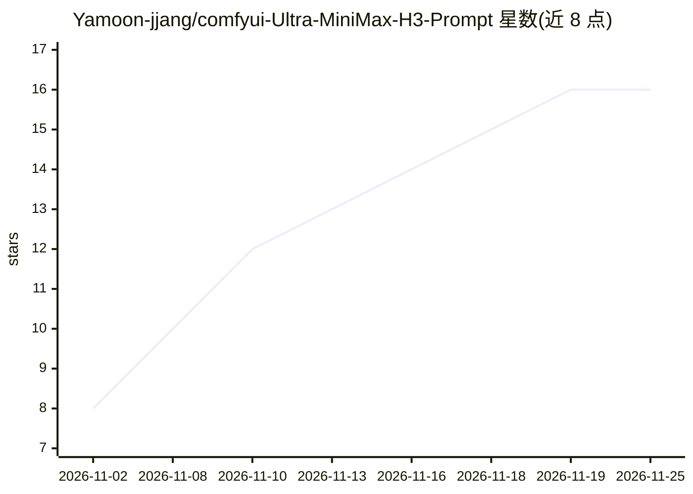

# Yamoon-jjang/comfyui-Ultra-MiniMax-H3-Prompt

⭐ 16 · Python · NOASSERTION · 推送 2026-11-10 · [GitHub](https://github.com/Yamoon-jjang/comfyui-Ultra-MiniMax-H3-Prompt) · 个人维护 · 中文 README

**为 MiniMax H3 视频模型生成结构化提示词的 ComfyUI 自定义节点**

面向 ComfyUI 用户的 MiniMax H3 视频提示词编译节点，提供 Main 与 R2V 两个独立节点：通过菜单与自然语言输入组织场景、最多 3 名人物、最多 6 个时间线事件、镜头、对白、环境音与音乐等要素，输出符合 H3 格式的结构化提示词。采用规则-based 编译与校验流程，不运行 LLM/VLM、不分析图像像素；支持韩语输入自动翻译为英语（Google 翻译路由 + MyMemory 回退，需联网），无需必选 pip 依赖。本节点不替代视频模型，实际渲染需另行接入 MiniMax H3 模型与生成工作流。

## 筛选速览

| 维度 | 判定 | 备注 |
|---|---|---|
| AI 角色 | `ai-ecosystem` | LLM/agent 周边工具 |
| 许可风险 | `none` | NOASSERTION |
| 部署形态 | `None` |  |
| 模型依赖 | — | README 未给出锁定关系 |
| 硬件要求 | — | 无带数字的原话,不猜 |
| 安装摩擦 | `low` | 无编译、无系统依赖或容器化 |
| 成熟度 | — | 结构信号不足 |

## 能力要点

- Main/R2V 双节点，覆盖 T2VA/I2VA/L2VA/FL2VA 及参考图/视频/音频的 R2V 模式
- 规则式提示词编译与校验（时长、说话人范围、场景结构等），不运行 LLM/VLM
- 韩语→英语自动翻译，含缓存、限速退避与 MyMemory 回退，API key 可选
- 无必选 pip 依赖，附 All-In-One 示例工作流 JSON

## 适用场景

- 在 ComfyUI 中为 MiniMax H3 视频生成组装结构化提示词
- 用韩语描述场景后自动转为 H3 所需的英文提示词
- 编排多人物、时间线事件与对白的长镜头视频提示词

## 场景标签

`提示工程` · 领域:Agent 开发

## 证据(README 行号)

> L5: 장면을 영어로 처음부터 직접 설계할 필요 없이 필요한 항목을 선택하고 작성하면, H3 형식에 맞는 **구조화된 영상 프롬프트**를 생성합니다. 이 노드는 영상 모델을 대체하지 않는 *프롬프트 생성기*이며, 실
> L53: 프롬프트의 규칙 기반 생성·검증 기능이며, **LLM/VLM을 실행하거나 입력 이미지의 픽셀 내용을 직접 분석하지는 않습니다.** 최종 영상의 내용 및 품질은 사용한 H3 모델, 참조 자료, 샘플링 설정에 
> L86: A rule-based ComfyUI prompt compiler for MiniMax H3 video generation.

## 星数曲线

2026-11-02 8 → 2026-11-25 16（+8）

---
*卡片 v1 · prompt 1.4 · 生成 2026-11-18 · 置信度 high · 依据 README sha `14c3b96c2cbb` · [字段定义](../../DATASET.md)*
